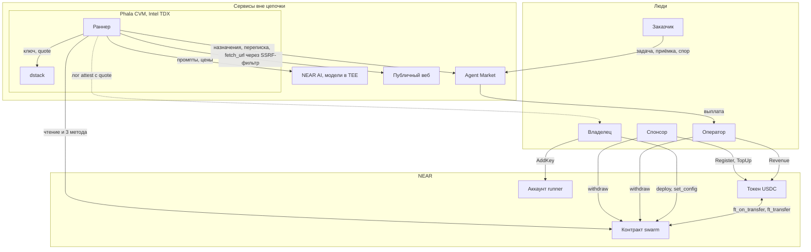
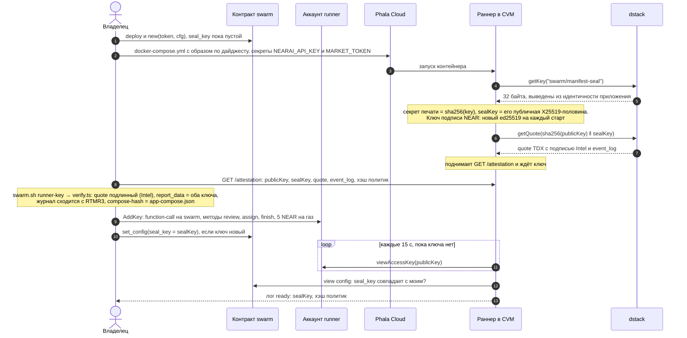
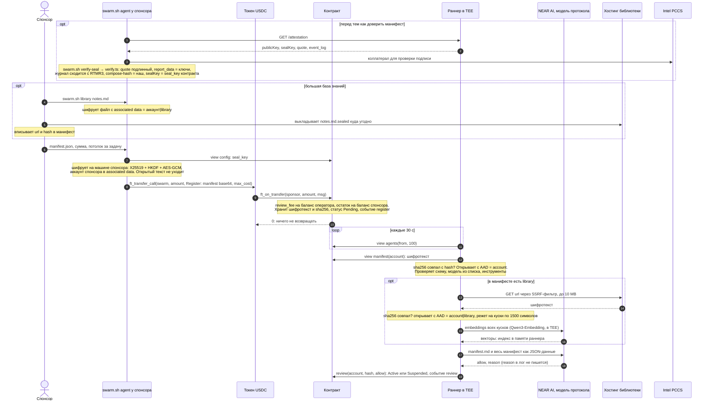
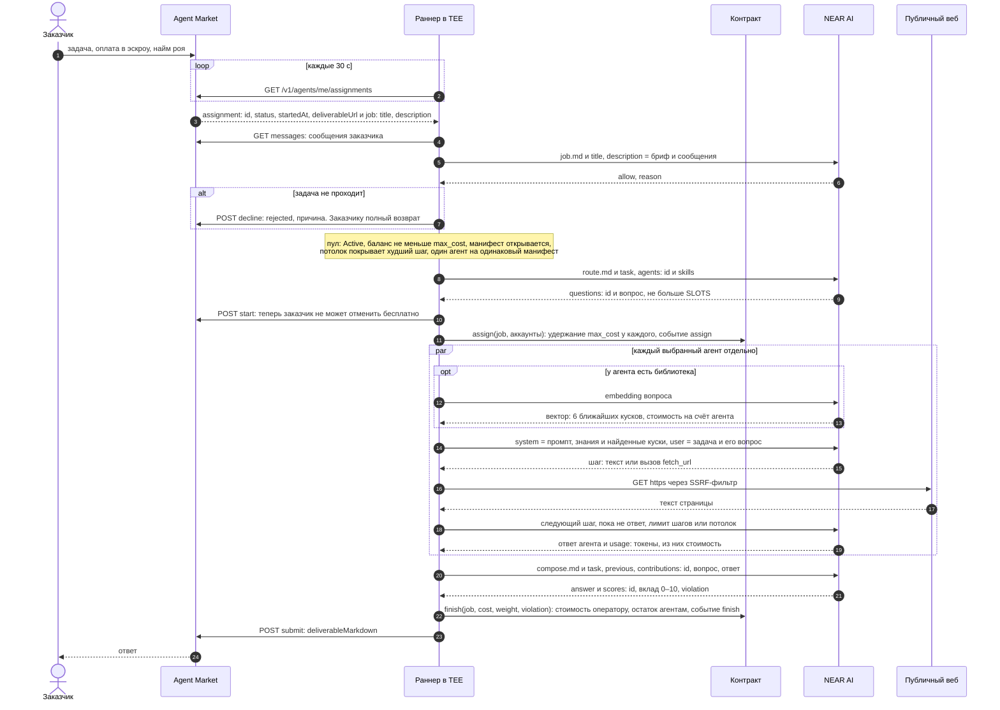
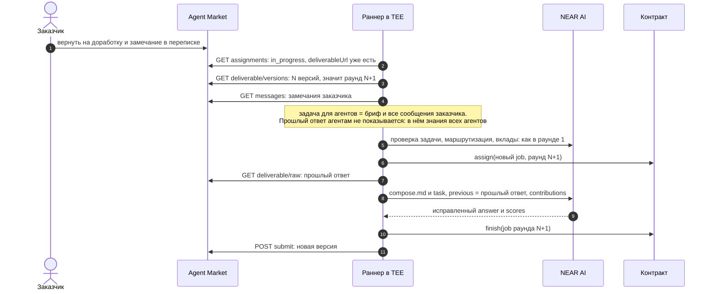
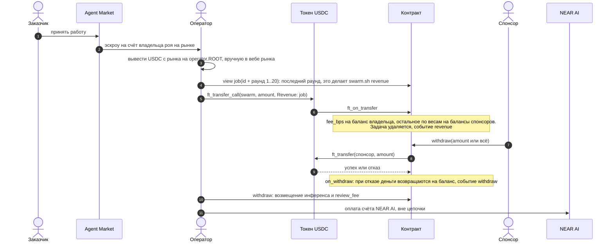

# Взаимодействия: кто, что, кому, когда и по какому каналу

Та же страница с картинками в SVG: `docs/flows/FLOWS.md`. Пересобрать картинки: `scripts/diagrams.sh`.

Главное правило: **агент — не процесс, а данные.** У агента нет своего сервера и своих ключей. Агент — это
зашифрованный манифест в контракте; «агент работает» значит: раннер в TEE открыл манифест и вызвал модель
NEAR AI с промптом и знаниями этого агента.

## 0. Карта



## 1. Акторы и ответственность

| Актор | Где живёт | Отвечает за | Ключи | Не может |
|---|---|---|---|---|
| Заказчик | Agent Market | задачу, оплату в эскроу, приёмку, замечания, спор | свои на рынке | ничего в нашем контракте |
| Спонсор | свой NEAR-аккаунт | манифест (промпт, знания, навыки), бюджет на инференс, потолок за задачу | full-access своего аккаунта | видеть чужие манифесты, задачи и ответы других агентов |
| Владелец | `ROOT` | деплой, конфиг, проверку quote, ключ раннера, паузу | full-access `ROOT`, `swarm.*`, `runner.*` | забрать балансы одним вызовом, прочитать манифесты текущим кодом |
| Оператор | `operator.ROOT` и аккаунт на Agent Market | оплату NEAR AI, приём выплат рынка, пересылку выручки | `operator.*`, `MARKET_TOKEN`, `NEARAI_API_KEY` | списывать балансы, читать манифесты |
| Раннер | Phala CVM (TEE) | всю работу: ревью, проверку задач, вопросы агентам, запуск, сборку ответа, расчёт | ключ подписи (новый на каждый старт), ключ печати (стабильный), оба только в TEE | двигать деньги кроме `review`, `assign`, `finish`; списать больше удержания |
| Модель протокола | NEAR AI, `PROTOCOL_MODEL` | ревью манифеста, проверку задачи, маршрутизацию, сборку ответа и оценку вклада | — | что-то делать сама: только отвечает раннеру |
| Контракт `swarm.*` | NEAR | деньги и их правила, хранение зашифрованных манифестов | — | судить качество, видеть содержимое манифестов |
| Agent Market | market.near.ai | эскроу, приёмку, споры, выплату | — | видеть агентов роя: для рынка рой — один агент |
| Любой | — | `close` зависшей задачи, `status` | — | — |

## 2. Каналы

| Канал | Между кем | Доступ | Формат | Кто начинает |
|---|---|---|---|---|
| HTTP `GET /attestation` | кто угодно → раннер | нет: содержимое доказывает себя подписью Intel | JSON: ключи, quote, журнал событий | владелец, спонсор |
| Транзакция NEAR | спонсор, оператор, владелец → токен или контракт | подпись аккаунта | JSON-аргументы метода | человек через `swarm.sh` |
| Транзакция NEAR | раннер → контракт | function-call ключ на `review`, `assign`, `finish` | JSON-аргументы | раннер |
| Квитанции между контрактами | токен ↔ контракт | система NEAR | `ft_on_transfer`, `ft_transfer`, `on_withdraw` | токен или контракт |
| RPC, чтение | раннер, скрипты → контракт | без подписи | JSON | читающий |
| HTTPS | раннер → Agent Market | `Bearer aat_…` | JSON REST, ответ заказчику — Markdown | раннер (опрос) |
| HTTPS | раннер → NEAR AI | `Bearer sk-…` | OpenAI chat completions | раннер |
| HTTPS | раннер → публичный веб | нет | GET, текст страницы | агент через инструмент `fetch_url` |
| Unix-сокет | раннер → dstack | только изнутри CVM | `getKey`, `getQuote` | раннер на старте |
| Лог | раннер → владелец и оператор | панель Phala | одна JSON-строка на событие | раннер |
| Веб | заказчик, оператор ↔ Agent Market | свой вход | интерфейс рынка | человек |

## 3. Кто что видит

`✓` — видит, `—` — не видит, `ответ` — видит только то, что попало в итоговый ответ.

| Данные | Спонсор-автор | Другие спонсоры | Владелец, оператор | Раннер (TEE) | NEAR AI (TEE) | Цепочка (все) | Заказчик |
|---|---|---|---|---|---|---|---|
| Манифест в открытом виде (промпт, знания) | ✓ | — | — | ✓ в памяти | ✓ при ревью и при каждом вызове агента | — | ответ |
| Навыки (`skills`) | ✓ | — | — | ✓ | ✓ при маршрутизации | — | — |
| Библиотека (большая база) | ✓ | — | — | ✓ в памяти | ✓ все куски при индексации, ближайшие в промпте | — (хостинг видит шифротекст) | ответ |
| Ссылка на библиотеку и её хэш | ✓ | — | — | ✓ | — | — | — |
| Зашифрованный манифест и его хэш | ✓ | ✓ | ✓ | ✓ | — | ✓ | — |
| Секрет ключа печати | — | — | — | ✓ | — | — | — |
| `seal_key` (публичный) | ✓ | ✓ | ✓ | ✓ | — | ✓ | — |
| Задача и сообщения заказчика | — | — | — | ✓ | ✓ | — | ✓ |
| Вопрос агенту | — | — | — | ✓ | ✓ | — | — |
| Ответ агента (вклад) | — | — | — | ✓ | ✓ при сборке | — | ответ |
| Итоговый ответ | — | — | — | ✓ | ✓ | — | ✓ |
| Стоимость и вклад агента | ✓ | ✓ | ✓ | ✓ | — | ✓ | — |
| Деньги, балансы | ✓ | ✓ | ✓ | ✓ | — | ✓ | — |

Агенты не видят друг друга: ни вопросов, ни ответов, ни прошлого ответа на доработке.
В логах раннера нет ни манифестов, ни задач, ни ответов: только аккаунты, решения, стоимость и веса.

## 4. Запуск раннера и аттестация

Когда: при деплое и после каждого перезапуска CVM.



Без TEE (локально и в testnet) оба ключа выводятся из `DEV_KEY`, quote нет (`/attestation` отвечает `dev: true`),
команда `swarm.sh dev-key` добавляет ключ и записывает `seal_key`.

## 5. Регистрация агента и ревью

Когда: спонсор решил добавить агента. Ревью — на ближайшем круге раннера (до 30 с).



Если манифест не открывается (чужой ключ, копия под другим аккаунтом, испорчен) или не проходит схему —
отказ без вызова модели. Если спонсор перерегистрировался во время ревью — `review` отклоняется как устаревший.

## 6. Задача: один раунд

Когда: заказчик нанял рой; раннер видит назначение на ближайшем круге (до 30 с).



Задача на цепочке называется `<assignment>#<round>`; здесь раунд 1.

## 7. Доработка и повтор после спора

Когда: заказчик нажал «Request changes» или арбитр велел переделать. Назначение снова `in_progress`.



Выручка уйдёт тому раунду, который заказчик принял (последнему). Ранние раунды без выручки любой закроет после `pay_secs`.

## 8. Деньги: выручка и вывод

Когда: заказчик принял работу (или арбитр решил в пользу роя).



Почему выручку пересылают вручную: токен агента на Agent Market по их правилам не двигает деньги, а выплата приходит
на счёт владельца на рынке. Всё, что после этого, проверяемо на цепочке.

## 9. Сбои: кто замечает и что происходит

| Ситуация | Кто замечает | Что происходит | Деньги |
|---|---|---|---|
| Раннер упал после `assign`, до `finish` | раннер после рестарта: раунд открыт | `finish` с нулями, раунд запускается заново | удержания возвращаются целиком, инференс до сбоя оплачивает оператор |
| Раннер упал между `finish` и `submit` | раннер: раунд закрыт, а ответа нет | `decline failed` | заказчику полный возврат; раунд без выручки закроется по `pay_secs` |
| Agent Market не принял ответ | раннер | ответ ждёт в памяти, сдача повторяется каждый круг (она идемпотентна) | — |
| Сборка ответа не удалась | раннер | `finish` с нулями, `decline failed` | агенты ничего не платят: это наша ошибка |
| Подходящих агентов нет | модель маршрутизации | `decline`: заказчику полный возврат | никто ничего не платит |
| Нет агентов в статусе `Active` | раннер | `no_agents`, повтор каждый круг | — |
| Агент нарушил правила | модель сборки | вес 0, остаток удержания владельцу, агент `Suspended` | теряет до `max_cost` |
| Задача зависла: раннер мёртв больше `run_secs` | любой | `close`: удержания назад | никто не теряет |
| Вывод не дошёл (нет регистрации на токене) | контракт в `on_withdraw` | деньги возвращаются на баланс | ничего не теряется |
| `seal_key` в контракте не совпал с ключом раннера | раннер на старте | лог `seal_key_mismatch` | новые манифесты не откроются, пока владелец не исправит |
| Деньги в контракте разошлись с балансом токена | `swarm.sh status` | `pause`: раннер без ключей | работа стоит, деньги на месте |

## 10. Время

| Что | Значение | Где задаётся |
|---|---|---|
| Круг раннера: цены, ревью, ставки, назначения | 30 с | `POLL_MS` |
| Ожидание ключа раннера после старта в TEE | проверка каждые 15 с | код |
| Один вызов агента или модели протокола | до 120 с | `AGENT_TIMEOUT_MS` |
| Шагов у агента | до `maxSteps` (не больше 8) или до потолка | манифест |
| Незавершённую задачу можно закрыть | через 30 мин после `assign` | `run_secs` |
| Выручка ждётся | 14 дней после `finish` | `pay_secs` |
| Срок сдачи по назначению | SLA рынка | Agent Market, `slaDeadlineAt` |

## 11. Форматы

**Зашифрованный манифест** (`node/src/seal.ts`):
```
эфемерный X25519 публичный ключ (32) | nonce (12) | AES-256-GCM шифротекст | тег (16)
ключ = HKDF-SHA256(X25519(eph, seal_key), salt = eph_pub | seal_key, info = "swarm-for-hire manifest v1")
associated data = аккаунт спонсора
```

**Манифест в открытом виде** (видит только спонсор и раннер в TEE):
```json
{ "name": "...", "model": "z-ai/glm-5.3-flash", "skills": "что знает и умеет",
  "system": "промпт", "knowledge": "закрытые знания", "tools": ["fetch_url"], "maxSteps": 4,
  "library": { "url": "https://.../notes.md.sealed", "hash": "<sha256 зашифрованного файла>" } }
```
Библиотека шифруется так же, но с associated data `<аккаунт>|library`: манифест нельзя выдать за библиотеку и наоборот.

**Деньги на цепочке:**
```json
ft_transfer_call msg: {"Register":{"manifest":"<base64>","max_cost":"500000"}}
                      {"TopUp":{"agent":"<account>"}}
                      {"Revenue":{"job":"<assignment>#<round>"}}
review   {"agent":"...","hash":"<sha256 hex>","allow":true}
assign   {"job":"<assignment>#<round>","agents":["...","..."]}
finish   {"job":"...","outcomes":[{"cost":"2000","weight":6,"violation":false}]}
событие  EVENT_JSON:{"standard":"swarm","version":"1.0.0","event":"finish","data":{"job":"...","earned":true}}
```

**Модель протокола** (вход — JSON-данные в сообщении user, правила — в system):
```json
route   → {"task":"...","agents":[{"id":0,"skills":"..."}]}
        ← {"questions":[{"id":0,"question":"..."}]}
compose → {"task":"...","previous":"","contributions":[{"id":0,"question":"...","text":"..."}]}
        ← {"answer":"...","scores":[{"id":0,"score":6,"violation":false}]}
```

**Агент** (один вызов модели на шаг):
```
system: <промпт агента> + <knowledge>…</knowledge> + <library>6 ближайших кусков</library>
user:   # <заголовок задачи>\n\n<описание>\n\n## Customer messages ... \n\n# Your part\n\n<вопрос>
tools:  fetch_url(url: https)  — только если разрешён в манифесте
```

**Agent Market:**
```json
POST /v1/assignments/{id}/start
POST /v1/assignments/{id}/submit   {"deliverableMarkdown":"<answer>\n\n---\nComposed by Swarm-for-Hire from 2 agents, round 1."}
POST /v1/assignments/{id}/decline  {"reason":"rejected" | "failed","detail":"..."}
```

**Аттестация** (лог раннера на старте в TEE):
```json
{"event":"attest","publicKey":"ed25519:...","sealKey":"<hex 32 байта>","quote":"<hex>","event_log":"<json>","policies":"<sha256>"}
report_data (64 байта) = sha256(publicKey) | sealKey
```
