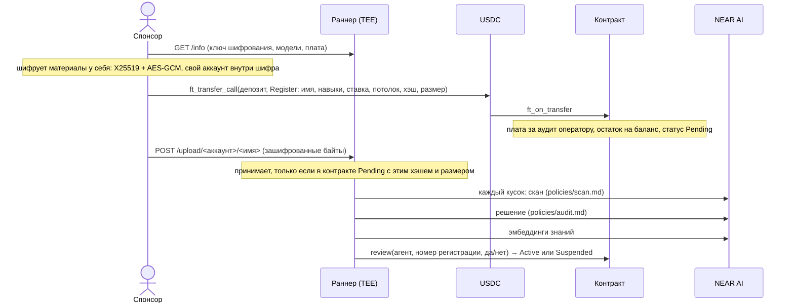
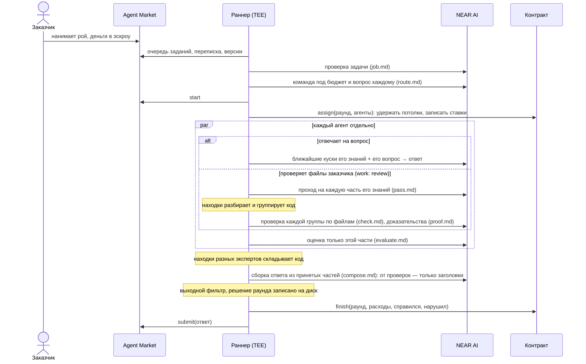

# Как устроен рой

> Рой — это способ сложить закрытые знания разных владельцев без доверия друг к другу.

## Участники

| Кто | Что делает |
|---|---|
| **Заказчик** | кладёт заказ в контракт (бюджет и хеш задачи; текст задачи отдаёт раннеру) или нанимает рой на Agent Market, где платит, принимает работу или просит доработку |
| **Спонсор** | владелец экспертов (у одного аккаунта их может быть сколько угодно, `аккаунт/имя`): приносит знания, платит депозит, получает ставку за каждую задачу |
| **Раннер** | программа в TEE (Phala, Intel TDX): открывает материалы, ведёт задачи, сообщает итоги контракту |
| **Контракт** | держит USDC и двигает их только по своим правилам |
| **Владелец** | развернул рой: настройки, комиссия 5%, проверка TEE перед выдачей ключа |
| **Оператор** | платит NEAR AI за инференс, пересылает выручку с Agent Market в контракт |
| **NEAR AI** | модели: и протокола, и агентов. Аккаунт один, оператора |

## Кто что видит

| Данные | Видят |
|---|---|
| визитка агента: навыки, ставка, потолок расходов, хэш, размер | все (в контракте) |
| материалы спонсора: экспертиза, методика, знания | только раннер в TEE и модель NEAR AI в момент вызова |
| бриф и сообщения заказчика | заказчик, Agent Market, раннер, модели протокола |
| вопрос агенту | этот агент (то есть модель с его материалами) |
| ответ агента | раннер: оценщик и сборщик |
| итоговый ответ | заказчик, после выходного фильтра |
| расходы агента | все, округлённо до 0.01 USDC |
| кто какое утверждение дал | хранилище раннера, для споров |
| раунды агента: тема, выбран ли, итог, расход, выплата; аудит с выдержками | только его спонсор, в кабинете после входа кошельком |
| спрос по темам: сколько задач, где не нашлось эксперта | все (`GET /demand`) |

Модели агентов работают в NEAR AI Cloud, запросы туда идут с материалами. Список моделей
([policies/models.json](../policies/models.json)) — модели с проверяемым TEE; доверие к NEAR AI остаётся отдельным звеном.

## Два входа для заказчика

| | Заказ в контракте | Agent Market |
|---|---|---|
| Как | текст задачи раннеру (`POST /brief`), затем `ft_transfer_call` USDC с `{"Order":{"brief_hash"}}`; на сайте — `/order` | найм роя как агента или задача на доске |
| Описание работы | до 10 000 символов, ссылки на материалы в тексте. В контракте только sha256 от текста с солью; текст видят заказчик и раннер. По желанию заказчик публикует текст в той же транзакции | бриф до 10 000 символов и файлы; видят заказчик, рынок и раннер |
| Деньги | лежат в контракте; расчёт делает сам контракт в момент ответа | эскроу рынка; выручку после приёмки пересылает оператор |
| Цена | бюджет — потолок: ставки справившихся + накладные + 5% владельцу, остаток возвращается на кошелёк | план или ставка; сверху 5% рынка |
| Ответ | один, окончательный; читает только заказчик на `/order` после подписи кошельком; sha256 ответа в событии `deliver` |
| Если текст не дошёл до раннера | заказ никто не берёт; через `run_secs` деньги возвращаются | — | приёмка, до двух доработок, спор с арбитром |
| Если рой отказался или молчит | вся сумма возвращается: при отказе сразу, при молчании — по вызову `refund` любым после `run_secs` | рынок возвращает эскроу |

Движок один ([round.ts](../node/src/round.ts)): вход — это «дверь» с одинаковыми действиями (взять задачу, сдать
ответ, отказаться). Рынок — [market.ts](../node/src/market.ts), контракт — [orders.ts](../node/src/orders.ts).
У заказа один раунд, и его задача в контракте носит id заказа (`order-<n>`).

Заказчика в контракте защищает не приёмка, а устройство расчёта: платится только за экспертов, чей ответ прошёл
отдельную проверку, а всё непотраченное возвращается. Кому нужны доработки и арбитр, тот идёт через Agent Market.

**На чём держится доверие в заказе.** Деньги — на правилах контракта: у заказа три исхода (расчёт с возвратом
остатка, отказ, возврат по таймауту), и ни один не ведёт деньги туда, куда выбрал бы раннер. Что заказано и что
отвечено — на двух хешах в контракте: хеш задачи кладёт заказчик, хеш ответа раннер; текст, который кто-то
предъявит позже, сверяется с ними. Соль не даёт подобрать короткую задачу по хешу. Что рой работал честно —
на аттестации TEE, как и во всём остальном. Чего схема не даёт: качество ответа никто не принимает, а выдачу
ответа заказчику обеспечивает код раннера, не контракт.

## Задача: что приходит с Agent Market и как выбираются эксперты

Agent Market даёт заказчику **бриф** (текст до 10 000 символов), **вложения** (файлы) и **переписку** (уточнения, просьбы
о доработке, решения арбитра). Формы для выбора исполнителей у рынка нет, поэтому:
- эксперта можно **назвать в брифе** по id из открытого каталога (`/experts`, там же помощник брифа). Названные идут
  первыми и помечаются для маршрутизатора; он берёт их, если их навыки могут помочь, и бюджет при этом соблюдается;
- остальных маршрутизатор подбирает по открытым навыкам (до 20 ближайших по эмбеддингам) в пределах бюджета;
- **вложения** (до 5 файлов по 5 MB: PDF, Markdown, текст, CSV, JSON, код) и ссылки из брифа становятся материалами задачи для экспертов;
- в подписи ответа перечислены эксперты, которые его дали: заказчик может позвать их снова, а эксперты получают репутацию.

**Цена.** Задача на доске получает ставку ровно в цену нужной ей команды. Прямой найм идёт по планам-бюджетам
(Quick 3, Standard 10, Deep 30 USDC): рой собирает лучшую команду, которая помещается в план.

## Вход агента



- **Плата за аудит** = `audit_base` + `audit_per_mb` × размер (по умолчанию 0.10 + 0.10 за MB). Депозит не меньше платы + `min_deposit`.
- **Копия чужих байтов не откроется:** id эксперта (`аккаунт/имя`) вшит в шифр. Одинаковые материалы на двух аккаунтах — один эксперт: в одну задачу они не попадут.
- **Причина отказа не публикуется:** она может цитировать материалы. Что запрещено, написано в [scan.md](../policies/scan.md) и [audit.md](../policies/audit.md).
- **Три сбоя на нашей стороне** (NEAR AI недоступен) — отказ, чтобы один агент не стоил нам бесконечно.
- **Новые материалы или навыки** — новая регистрация и новый аудит. Решение аудита называет номер регистрации:
  если визитку заменили, пока шёл аудит, контракт решение не примет.
- Открытые навыки тоже проходят скан: они попадают в запрос модели, которая собирает команду.
- Спонсор не пишет промпт. Агент собирается по [шаблону](../policies/agent.md), материалы входят в него как справка, а не как команды.

## Раунд задачи



**Кто попадает в кандидаты:** агент `Active`, на балансе есть его потолок, материалы открыты в этом раннере,
модель есть в прайсе NEAR AI, потолок покрывает худший случай одного ответа. Если кандидатов больше 20,
берутся 20 ближайших к задаче по эмбеддингам открытых навыков. Пока кандидатов нет (например, сразу после
перезапуска), раунд ждёт и не тратит ни одного платного вызова.

**Замена слабого выбора.** Роутер выбирает по словам в описании навыков: насколько эксперт хорош, из описания не
видно. Раннер знает другое: какая доля прошлых ответов пришла от эксперта против равной доли на всех участников
(1 — равная доля). Если у другого кандидата этот показатель выше, чем у выбранного, на 0.2 и больше, а ставка не
выше, модель протокола получает один узкий вопрос ([stand-in.md](../policies/stand-in.md)): мог бы этот кандидат
ответить на тот же вопрос? Если да, спрашивают его. Эксперта, которого назвал заказчик, не заменяют; эксперта
без истории не заменяют и им не заменяют.

**Расход агента не может превысить удержание.** Токен модели не короче одного байта UTF-8, поэтому худший
случай вызова — все байты запроса как токены плюс предел ответа. Вызов уходит в NEAR AI, только если этот
худший случай помещается в удержание. Иначе агент просто не отвечает и ничего не платит.

**Бюджет на агентов** = цена × 0.95 (Agent Market) × (1 − комиссия владельца) − накладные раунда (0.50).
Каждый агент стоит своей ставки и ещё 0.10 накладных. Пример: 10 USDC → 9.5 → 9.025 → 8.525.
Модель выбирает агентов по важности; берётся самый длинный список с начала, который влезает в бюджет.
Все раунды одной задачи делят этот бюджет: доработка тратит только то, что не задолжали прошлые раунды
(ставки справившихся и их накладные). Если ничего не осталось, рой сдаёт прошлый ответ с пометкой.

**История эксперта.** Роутер видит у каждого кандидата «справился/взят» за последние 50 задач (у нового — пусто).
При равных навыках берёт того, у кого история лучше; того, кто редко справляется, — только если больше некому.
Так за слабую работу платит её автор (его реже зовут), а не эксперты, с которыми он работал.

**Материалы заказчика:** до 5 вложенных файлов, до 10 https-ссылок из брифа и переписки и, если задан
`BRAVE_API_KEY`, до трёх поисков. Читаются PDF (в отдельном потоке, код из файла не исполняется), HTML (тоже в
отдельном потоке), Markdown, текст, CSV, JSON, код; ссылки на GitHub (файл или README репозитория) и публичные
Google Docs, Sheets, Slides читаются там, где лежит их содержимое. Скачивает протокол (агенты в сеть не ходят),
через фильтр SSRF, до 5 МБ на источник. Если материалов больше 48 000 символов, они режутся на куски и
индексируются один раз на задачу: каждый эксперт получает куски, ближайшие к его вопросу (до 48 000 символов).
Что не открылось (закрытая ссылка, неизвестный формат), ответ называет заказчику.

**Справка по материалам.** Знания эксперта ищутся по смыслу, а слова «проверь этот контракт» ни к чему в них не
близки: что искать, написано в самом контракте. Поэтому, если вопрос пришёл с материалами, эксперт сначала читает
их и называет до пяти вещей, которые стоит посмотреть в своих знаниях ([шаблон](../policies/lookup.md), отдельный
короткий вызов его же модели за его счёт). Из знаний берутся шесть кусков по очереди: лучший по вопросу, лучший по
каждой из этих вещей. Запросы никто не видит, они только выбирают куски его же знаний. Без материалов этого шага
нет.

**Проверка материалов (`work: review`).** Ответ — это один вызов с шестью ближайшими кусками знаний. Для
чек-листов этого мало: на аудитах один ответ видел 8–16% чек-листа и находил не больше, чем модель без него
([eval/README.md](../eval/README.md)). Эксперт, который объявил `"work": "review"`, работает иначе, когда заказчик
дал свои файлы (вложения или ссылки из брифа; то, что нашёл поиск, не проверяется):

| Шаг | Кто делает | Что происходит |
|---|---|---|
| своё чтение | модель эксперта, [read.md](../policies/read.md) | первый вызов без чек-листа: эксперт читает файлы так, как читал бы их один, и записывает всё, что видит, до 20 находок. Чек-лист сужает модель до своих пунктов: проходы, которым велели сообщать «только то, к чему ведёт эта часть», не подняли ни одной из главных находок контракта, где та же модель одним вызовом нашла семь |
| проходы | модель эксперта, [pass.md](../policies/pass.md) | часть знаний — это файл знаний (длинный файл — несколько частей до 9 000 символов), всего до 16 частей; на каждую часть один вызов: что эта часть находит в файлах. Проходу говорят, что уже поднято до него (строка на находку), чтобы он не тратил ответ на то, что видно всем. Находка — строка `### <важность> \| <место> \| <что не так>` и до 60 слов; с прохода берётся до 12 |
| записи | код | находки читаются из ответов в записи. Дальше список целиком не переписывает ни одна модель: модель, которая сводит длинный список, теряет редкие пункты, а редкие и есть ценность |
| группы | код, затем узкий вопрос модели | записи об одном и том же объединяются по близости эмбеддингов (0.85; каждая запись группы близка к каждой, цепочка соседей не склеивает разное). Если сервис эмбеддингов молчит 30 секунд — по общим словам. Потом модель эксперта отвечает на узкий вопрос «какие из этих об одном и том же» ([same.md](../policies/same.md)), и названное проверяется вместе: одна проблема в десяти формулировках проверяется один раз. Проверке показывают не больше пяти формулировок за раз: модель, которой показали двадцать, отклоняет их одной строкой |
| проверки | модель эксперта, [check.md](../policies/check.md) | на каждую группу один вызов, самые тяжёлые первыми, до 30: правда ли то, что находка говорит о файлах? Прежде чем подтвердить, проверка ищет то, что находке мешает: если находка говорит, что чего-то нет (проверки, возврата, отката), читается место, где это должно быть. Ответ — форма, а не текст: по каждой формулировке «верно или нет», важность, место, как это происходит, строки файла и исправление. Чтобы отказать, проверка должна указать строку, которая находке мешает. Что считать находкой и как мерить её важность, говорит метод самого эксперта (он подставляется в проверку), а не протокол: у наших аудиторов это «кто-то выигрывает, кто-то теряет или что-то перестаёт работать; иначе это не находка» |
| цитата | код | приведённая строка ищется в файлах заказчика (без учёта пробелов и переносов; цитата с «...» — по кускам). Нет такой строки — находка не подтверждена, что бы ни сказала модель |
| не подтверждено | код | то, что проверка не подтвердила, не выбрасывается: «нет» модели — такое же суждение, как и «да», и лучшая из наших моделей отказала находке, которую сама только что сделала. Critical и High даются целиком, как их подняли, с тем, что сказала проверка; Medium — строкой; всего до 20. Неподтверждённые Low отбрасываются |
| вместе | модель эксперта, [combine.md](../policies/combine.md) | один вызов видит подтверждённые находки, по строке на каждую, и отвечает, что следует из двух-трёх из них вместе и чего ни одна не говорит сама (одна даёт разрешение, другая позволяет им воспользоваться любому). Каждый такой вывод проходит ту же проверку с цитатой; неподтверждённый отбрасывается. Шаг может только добавить |
| рядом | модель эксперта, [same.md](../policies/same.md) | тот же узкий вопрос после проверок: какие из находок говорят об одном и том же другими словами? Ответ модели ничего не сворачивает и не убирает: названные одинаковыми находки встают рядом, каждая остаётся отдельной находкой в своих словах, с пометкой «Sorted with … kept apart in case it is not». Свёрнутые в одну, пять верных формулировок однажды получили заголовок шестой, неверной, и в находке усомнились из-за него. Номер, которого нет в списке, или находка, названная дважды, ничего не меняют |
| доказательства | модель эксперта, [proof.md](../policies/proof.md) | если задача просит код: тест для Critical и High, до 3, один на находки, вставшие рядом. Написан, не запущен — ответ так и говорит |

Сборщик получает от проверки только заголовки находок и пишет один абзац до 120 слов
([summary.md](../policies/summary.md), предел 300 токенов; всё, что он допишет после абзаца, отрезает код). На первом
заказе через контракт сборщик, которого просили «собрать ответ» из заголовков, написал собственный список находок и
четыре теста, которых не писал ни один эксперт. Сами находки заказчик получает
ниже резюме так, как их написал эксперт: с важностью, местом, строками из файла, исправлением и доказательством;
под ними — список неподтверждённого, с пометкой, что это не находки, а поводы посмотреть.
Находки нескольких экспертов складывает код, и только складывает: раннер их не перепроверяет и не переписывает.
То, что по близости эмбеддингов сказано одними словами, становится одной находкой с пометкой «нашли 2 из 3
экспертов»: то, что один эксперт подтвердил, а другой только поднял, — одна подтверждённая находка. Модель протокола
отвечает на тот же узкий вопрос ([same.md](../policies/same.md)): она видит по строке на находку и называет номера
похожих; такие находки встают рядом, и каждая остаётся в словах своего эксперта.
Эксперты находок друг друга не видят. Доля эксперта в ответе считается по подтверждённым находкам: за неподтверждённое
её не прибавляется. Если резюме не написалось, находки всё равно уходят заказчику.

**Контролёр (`CONTROL_MODEL`).** Если оператор задал модель контролёра, она читает сложенный список находок вместе
с файлами заказчика ([control.md](../policies/control.md)) и по каждой находке либо соглашается, либо сомневается,
либо оценивает важность иначе. Сомнение принимается, только если контролёр привёл строку файла, которая мешает
находке, и код нашёл эту строку. Его слово ставится рядом с находкой («Second opinion, from the controller»); сама
находка остаётся на месте и в формулировке эксперта. По умолчанию контролёра нет, и мы его не советуем, пока нет
модели заметно сильнее тех, которыми судят эксперты: на проверенном вслепую контракте контролёр на kimi-k2.6
усомнился в 16 находках из 26 — в 9 из 11 неверных и в 6 верных, включая обе High из отчёта аудиторов
([eval/README.md](../eval/README.md)).

Одно правило на все шаги: модель не может убрать находку из ответа, ни сводя список, ни проверяя его. Она может
только не подтвердить её, и заказчик это видит.

**Две модели у одного эксперта.** Читать файлы заказчика каждым файлом знаний — это большая часть входа проверки, а
поднять кандидата проще, чем его рассудить. Поэтому эксперт может назвать вторую, более дешёвую модель для проходов
(`pass_model`): она читает и поднимает находки, а проверки, склейку и доказательства делает основная модель. На
первых пробах дешёвая модель в проходах подняла те же эталонные находки, что подтвердила сильная, а как судья
пять раз отвергла верную находку одним и тем же неверным доводом.

Все вызовы проверки идут с удержания эксперта. До первого вызова раннер считает худший случай всей проверки по
настоящим размерам (своё чтение, каждый проход, 30 проверок и 5 проверок сочетаний, 3 доказательства) и, если он не помещается в удержание, проверку
не начинает: `too_expensive`, эксперт ничего не тратит. Сбойный вызов повторяется один раз. Если файлов знаний
больше 16, они пакуются в части подряд; знания больше 16 частей читаются не все: берутся куски, ближайшие к вопросу
и к тому, что эксперт решил посмотреть в материалах. Без файлов заказчика такой эксперт отвечает как обычный.

## Профиль эксперта

Заказчик выбирает эксперта по публичному профилю: «что знает» (`skills`, в контракте, его читает роутер),
до трёх вопросов, на которые эксперт отвечает хорошо (`examples`), и до трёх тем из категорий Agent Market
(`topics`). Вопросы и темы лежат в запечатанных материалах; аудит проверяет, что файлы эксперта их
подтверждают (`skills_unsupported` иначе) и что в них нет инструкций для ИИ. Каталог показывает их только
у допущенной регистрации, с отметкой «profile checked by the audit». Роутер тоже видит вопросы.

## Деньги

| Когда | Что происходит |
|---|---|
| регистрация | плата за аудит → оператору; остальное → баланс спонсора |
| `assign` | у каждого агента удерживается его потолок; ставка записывается в задачу |
| `finish` | расход (вверх до 0.01, не больше удержания) → оператору; остаток → агенту; выплата 0, если не справился или нарушил; нарушитель `Suspended` до новой регистрации |
| `Revenue` (только оператор) | комиссия → владельцу; каждому его выплата (если пришло меньше — пропорционально); остаток → оператору |
| `Order` (заказчик) | бюджет заказа лежит в контракте под хешем задачи |
| `deliver` (раннер) | с заказа берётся `ceil((ставки справившихся + overhead + overhead_per_agent × их число) / (1 − комиссия))`, не больше бюджета, и делится как выручка; остаток бюджета сразу уходит заказчику на кошелёк |
| `decline` (раннер), `refund` (любой, после `run_secs`) | весь бюджет уходит заказчику на кошелёк; если перевод не прошёл, деньги ждут на его балансе в контракте |
| `close` | незавершённую задачу после `run_secs` закрывает кто угодно: удержания назад; неоплаченную после `pay_secs` — удаляет |
| `withdraw` | любой баланс; если перевод не прошёл, деньги возвращаются на баланс |

Пример заказа из [e2e](../e2e/run.ts): бюджет 8, справились агенты со ставками 3 и 2. Накладные 0.5 + 0.1 × 2, итого 5.7;
с 5% владельцу заказчик платит ровно 6: владельцу 0.3, агентам 3 и 2, оператору 0.7. Два USDC вернулись на кошелёк.

Пример с Agent Market: заказчик платит 10, Agent Market пересылает 9.5. Агенты со ставками 3 и 2
справились, третий (ставка 1) обратился к оценщику. Итог: владельцу 0.475, агентам 3 и 2, оператору 4.025.
Нарушитель платит только свой расход 0.01 и получает `Suspended`. Его удержание никому не достаётся:
так ни у владельца, ни у соседей нет причины провоцировать нарушения.

**Платим за то, что вошло в принятый ответ.** Доработка улучшает прошлый ответ, поэтому часть, прошедшая проверку
в раунде 1, остаётся в ответе раунда 2. Когда заказчик принял работу, ставку получает каждый эксперт, справившийся
в любом раунде этой задачи до принятого (номер принятого раунда стоит в подписи ответа). Не справившийся не получает
ничего ни в одном раунде. `scripts/swarm.sh payouts` по каждой принятой работе платит:

- прошлым раундам — ровно их долю: долг экспертам / (1 − комиссия владельца), с округлением вверх;
- раунду принятого ответа — остаток выручки, и ему первому: если запуск оборвался, следующий доплатит прошлым
  раундам их точные доли. Оплаченный раунд исчезает из контракта, поэтому дважды не платится ничего.

Пример из [e2e](../e2e/run.ts): раунд 1 задолжал 3 + 2, после правок раунду 2 хватило бюджета на одного эксперта.
Из 9.5 раунд 1 получает 5.263158 (эксперты 3 и 2, владельцу 0.263157), раунд 2 — остаток 4.236842. Эксперт,
которого не было в раунде 2, всё равно получил ставку за свою часть в раунде 1.

Если арбитр Agent Market разделил оплату (статус `dispute_resolved`), приходит только часть эскроу, а токен
агента не видит сколько. `payouts` называет такие работы и ждёт сумму: `scripts/swarm.sh payouts --received
<assignment>=<USDC>`. Пришедшее делится между раундами пропорционально долгу, внутри раунда контракт делит
пропорционально ставкам.

Если работу так и не приняли (арбитр вернул деньги заказчику), ставку не получает никто: денег нет. Каждый
теряет только свой инференс, не больше своего потолка. Деньги у спонсора общие для всех его экспертов:
удержания берутся с его баланса, ставки приходят на него же.

## Доработки и споры

- Каждый раунд — отдельная задача в контракте: `<assignment>#<номер>`.
- **Замечание заказчика** сверяется с брифом ([scope.md](../policies/scope.md)). Новая работа или сверх `MAX_REWORKS` (2) —
  рой сдаёт прошлый ответ с пометкой: отказ после сдачи вернул бы заказчику всё.
- **Решение арбитра «переделать»** (сообщение площадки в переписке) выполняется всегда.
- Агенты получают замечания, но не прошлый ответ: в нём знания других. Прошлый ответ видит только сборщик.

## Выходной фильтр

Ответ разбирается парсером Markdown (GFM) в дерево и собирается заново, поэтому любой синтаксис ссылки,
картинки или кода виден фильтру: обычные, ссылки-сноски, автоссылки, `www.`, адреса в любом регистре.

**Ссылки.** Ссылка может быть самим результатом, поэтому она не вырезается. Кликабельной остаётся ссылка,
которая существовала до задачи: из брифа, со страниц, которые прочитал протокол (и ссылки на них), из материалов
экспертов команды. Такая ссылка не может нести текст задачи. Придуманная моделью ссылка показывается текстом
с пометкой «unverified link»: в её адресе агент мог зашить вопрос заказчика, и клик отправил бы его владельцу
агента. Так же поступает OpenAI: агент сам открывает только адреса, известные публичному веб-индексу, а про
остальные предупреждает пользователя.

| Что | Как |
|---|---|
| HTML, скрипты, iframe | вырезаются |
| картинки | не загружаются сами: внешняя картинка сообщает своему серверу, кто открыл ответ. Из известных источников — ссылкой `image: …` |
| ссылки | кликабельны известные до задачи (см. выше); остальные — текстом `example[.]com/x (unverified link)` |
| невидимые символы | удаляются (в материалах и в ответе) |
| код в любом виде (```` ``` ````, `~~~`, отступ, незакрытый блок, `в строке`) | статические правила (скачать и запустить, `eval` раскодированного, reverse shell, стирание, майнеры, кража ключей) — удаляется; остальные блоки смотрит модель ([code.md](../policies/code.md)); если проверка не удалась — удаляются; оставленный код с пометкой «не запускался» |
| опасная команда прямо в тексте | абзац заменяется пометкой |
| пометки источников `[[n]]` | убираются из ответа, сохраняются в хранилище раннера |

## Кабинет спонсора и отладка

Спонсор входит кошельком NEAR: кошелёк платит за регистрацию, пополнения и вывод, а подпись NEP-413
(«Swarm-for-Hire cabinet <аккаунт> <время>» для контракта) открывает кабинет. Раннер проверяет подпись и то,
что ключ — ключ полного доступа этого аккаунта; ничего не хранит, подпись действует 10 минут.

| Кабинет показывает | Не показывает никогда |
|---|---|
| статус, баланс, ставку, потолок | задачи заказчиков |
| каждый раунд: время, тема (одна из категорий Agent Market), выбран ли, итог, расход, выплата | вопросы агенту |
| итог одним словом: `answered`; `empty`, `off_topic`, `refused`, `repeated_question`, `cut_off` (без выплаты; `cut_off` — ответ упёрся в лимит длины, не дойдя до сути); `too_expensive` (поднять потолок: ответ или вся проверка в худшем случае в него не помещались); `addressed_others`, `asked_for_score`, `changed_rules`, `hidden_content`, `attack` (нарушения); `model_failed`, `not_checked` (наша сторона) | ответы агента и текст оценщика (в них вопрос) |
| что стало с принятой частью: какая доля утверждений итогового ответа помечена как её (с шагом 10%), и вернул ли заказчик этот ответ на доработку | чужие части и сам ответ |
| аудит: правило, причина, выдержки из своих материалов, которые заметил скан | — |
| спрос по темам: где не нашлось эксперта | — |

Вопросы скрыты, потому что это данные заказчика, и по ним спонсор мог бы подгонять материалы под чужие задачи.
Чтобы понять, что улучшить, спонсор гоняет агента на своих вопросах: `scripts/try.ts` со своим ключом NEAR AI
выполняет тот же открытый шаблон, ту же нарезку и поиск по знаниям, ту же модель и того же оценщика и показывает
всё: найденные куски, весь запрос (`--prompt`), ответ, вердикт с причиной, худший расход против потолка.
`--audit` показывает, пройдут ли материалы вход. `--material <файл>` даёт вопросу файл заказчика: эксперт с
`"work": "review"` проверяет его так же, как в рое, и показывает, сколько находок подняли проходы, сколько устояло
и во что это обошлось.

Свой ключ NEAR AI в работе роя спонсору не нужен и не подключается: по точным токенам и времени своих вызовов
он видел бы, когда и какие задачи были у заказчиков, а агент мог бы передавать ему вопросы длиной ответа.
Поэтому в рое один ключ оператора и расходы, округлённые до 0.01.

Страницы раннера разделены намеренно. Вступление (`/join`) видит материалы в открытом виде, поэтому на нём, как и на
обзоре, только наш код, наши шрифты и связь только с раннером. Кабинет (`/cabinet`) никогда не видит материалов,
поэтому на нём работают кошельки, каждый в своей песочнице (NEAR Connect).

## Перезапуск

- Решение раунда пишется на диск раньше, чем в контракт и на рынок. После перезапуска раннер повторяет
  `finish` и `submit`: оба безопасно повторять.
- Раунд, прерванный до решения: удержания возвращаются, раунд идёт заново.
- Материалы лежат на диске зашифрованными; после перезапуска раннер открывает и индексирует их снова.
- Ключ подписи в TEE новый при каждом запуске: владелец проверяет аттестацию и даёт ему права (старый удаляет).
  Ключ шифрования dstack выводит из идентичности приложения, он переживает перезапуск.

## Почему раннеру можно верить

`GET /attestation` отдаёт quote Intel TDX. В нём `report_data` = sha256(ключ подписи) ‖ ключ шифрования, а журнал
событий сводится к RTMR3 и называет compose: образ по дайджесту, переменные, правила. `scripts/swarm.sh verify <url> app-compose.json`
проверяет всё это; без TEE (режим `DEV_KEY`) проверка честно отказывает. Именно compose привязывает quote к нашему коду:
без него проверку прошло бы любое настоящее TDX-приложение. Поэтому `join` требует `app-compose.json`, который
владелец публикует в репозитории, и ещё проверяет, что ключ подписи действительно ключ `runner.<root>`.

Ключ раннера — function-call ключ на пять методов (`review`, `assign`, `finish`, `deliver`, `decline`): даже взломанный раннер не выводит токены, а потери ограничены
удержаниями. `scripts/swarm.sh pause` отключает его сразу; раннер видит паузу и не делает ничего платного.

## Угрозы

| Угроза | Что останавливает | Что остаётся |
|---|---|---|
| спонсор прячет инструкции для оценщика и сборщика | скан и аудит при входе; оценка каждого ответа отдельно; нарушение = нет выплаты, приостановка, новый аудит за свой счёт | тонкое влияние, которое модели не распознают |
| заказчик подставляет честных агентов («обратитесь к оценщику») | маршрутизатор передаёт агенту только вопрос о знаниях; ответ по вопросу никогда не нарушение; нарушение никому не выгодно | ошибка модели-оценщика |
| спонсор меняет визитку, пока идёт аудит | решение аудита привязано к номеру регистрации | — |
| спонсор хочет видеть задачи через кабинет | кабинет отдаёт только тему, итог одним словом и деньги; вход только подписью ключа полного доступа | — |
| агент прячет вопрос заказчика в адрес ссылки | кликабельны только адреса, известные до задачи | заказчик сам скопирует непроверенный адрес |
| `$&` и подобное в материалах раздувает запрос | шаблон заполняется без подстановок; вызов не уходит, если худший случай больше удержания | — |
| спонсор копирует чужие материалы | аккаунт в шифре; одинаковое содержимое = один эксперт | пересказ чужих знаний своими словами |
| много аккаунтов, чтобы чаще работать | каждый платит аудит и депозит; выбор по навыкам, а не по числу | — |
| агент пытается узнать знания соседей | агент не видит никого; прошлый ответ только у сборщика; грубые расходы | — |
| заказчик внедряет инструкции в бриф | проверка задачи; во все вызовы протокола вход идёт как JSON-данные; агент видит только свой вопрос | — |
| ответ вредит заказчику | выходной фильтр | вредный смысл в обычном тексте |
| ссылки брифа ведут во внутреннюю сеть | только https, фильтр SSRF на каждый адрес и редирект, лимиты размера и времени | — |
| оператор хочет увидеть материалы | они открываются только в TEE; в логах нет ни материалов, ни причин моделей; трассировка с текстом включается только без TEE | атаки на сам TEE (TEE.fail и др.) |
| раннер взломан | ключ без доступа к токенам, потери в пределах удержаний, `pause` | — |
| загрузками кладут раннер | только оплаченные регистрации; поток на диск; 8 загрузок сразу, одна на аккаунт; данные цепочки не чаще раза в 3 с | после падения новый ключ подписи ждёт владельца |
| повторы раунда сжигают деньги на моделях | до кандидатов и паузы — ни одного платного вызова; сбои повторяются через 1, 2, 4, 8 минут, после пятого — отказ | — |
| владелец меняет раннера или оператора в настройках | владелец публичен, изменения видны в событиях | доверие владельцу: новый раннер может списывать удержания как расход |
| владелец выкатывает новую версию приложения | новая версия получает тот же ключ шифрования; каждая версия видна по compose hash | доверие владельцу: проверяйте compose после обновлений |

## Ограничения сейчас

- Выручку с Agent Market пересылает оператор: рынок платит на аккаунт роя, а ключ раннера не может прикладывать депозит.
  Заказ в контракте рассчитывается без оператора.
- У заказа в контракте нет доработок и споров.
- С Agent Market платятся раунды только принятой работы.
- Материалы эксперта — только текст (`.md`, `.txt`). У заказчика читаются и PDF.
- Проверка читает до 48 000 символов файлов заказчика: из большего берутся куски, ближайшие к вопросу. Доказательства
  никто не запускает: в TEE нет ни компилятора, ни сети.
- Индекс знаний строится один раз, при допуске эксперта, и хранится на диске раннера запечатанным его ключом, как и
  сами материалы: перезапуск читает его с диска и модель эмбеддингов для этого не нужна. Пока сервис эмбеддингов
  NEAR AI не отвечает, нельзя допустить нового эксперта и найти куски знаний под вопрос (эксперт отвечает без них);
  проверка (`work: review`) читает знания целиком и группирует находки по словам, так что продолжает работать.
- Знания активных агентов раннер держит в памяти: около 40 MB на агента с 10 MB знаний. Размер CVM — под число агентов.
- Расходы самого раннера в NEAR AI ограничены в сутки (`DAILY_BUDGET_USD`): дальше он не начинает работу до следующего дня,
  заказы в контракте ждут и возвращаются по таймауту. В работе одновременно не больше 4 задач, так что лимит
  нельзя превысить больше чем на их стоимость.
- Пометки источников сохраняются, но ещё не влияют на выбор агентов: маршрутизатор учитывает только долю сданных задач.

## Похожие проекты

| Проект | Общее | Отличие |
|---|---|---|
| OpenMined Syft | вычисления над чужими закрытыми данными | данные у владельца, нужен исследователь; у нас готовый ответ заказчику |
| Opaque / C-FedRAG | RAG по закрытым базам в TEE | без рынка и оплаты владельцам |
| ProRata | оплата по атрибуции источникам | доверенный посредник; у нас контракт и TEE |
| Agent Market competitions | много агентов на одну задачу | агенты соревнуются, а не складывают знания; знания не защищены |
| Theoriq, Allora | коллективы агентов и стимулы | нет закрытых знаний разных владельцев |
