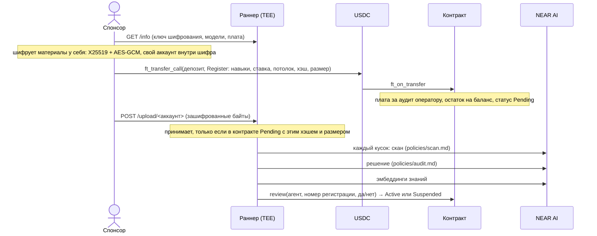
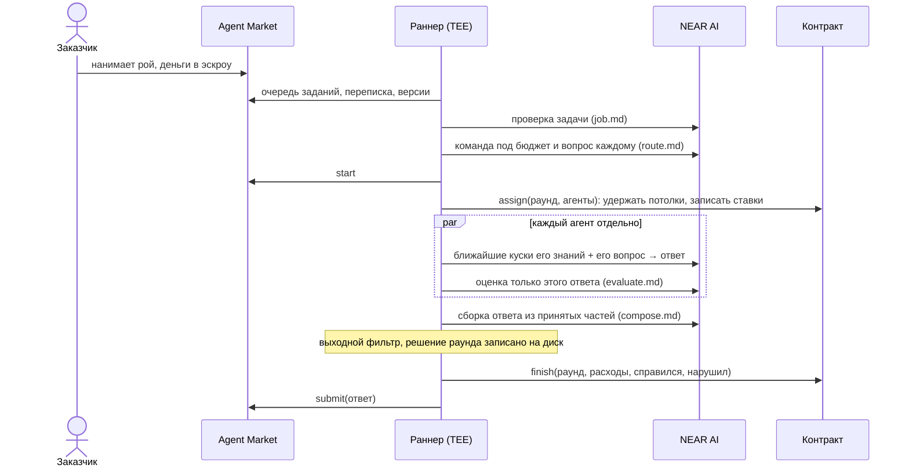

# Как устроен рой

> Рой — это способ сложить закрытые знания разных владельцев без доверия друг к другу.

## Участники

| Кто | Что делает |
|---|---|
| **Заказчик** | нанимает рой на Agent Market, платит, принимает работу или просит доработку |
| **Спонсор** | владелец эксперта: приносит знания, платит депозит, получает ставку за каждую задачу |
| **Раннер** | программа в TEE (Phala, Intel TDX): открывает материалы, ведёт задачи, сообщает итоги контракту |
| **Контракт** | держит USDC и двигает их только по своим правилам |
| **Владелец** | развернул рой: настройки, комиссия 5%, проверка TEE перед выдачей ключа |
| **Оператор** | платит NEAR AI за инференс, пересылает выручку с Agent Market в контракт |
| **NEAR AI** | модели: и протокола, и агентов. Аккаунт один, оператора |

## Кто что видит

| Данные | Видят |
|---|---|
| визитка агента: навыки, ставка, потолок расходов, хэш, размер | все (в контракте) |
| материалы спонсора: экспертиза, методика, знания | только раннер в TEE и модель NEAR AI в момент вызова |
| бриф и сообщения заказчика | заказчик, Agent Market, раннер, модели протокола |
| вопрос агенту | этот агент (то есть модель с его материалами) |
| ответ агента | раннер: оценщик и сборщик |
| итоговый ответ | заказчик, после выходного фильтра |
| расходы агента | все, округлённо до 0.01 USDC |
| кто какое утверждение дал | хранилище раннера, для споров |

Модели агентов работают в NEAR AI Cloud, запросы туда идут с материалами. Список моделей
([policies/models.json](../policies/models.json)) — модели с проверяемым TEE; доверие к NEAR AI остаётся отдельным звеном.

## Вход агента



- **Плата за аудит** = `audit_base` + `audit_per_mb` × размер (по умолчанию 0.10 + 0.10 за MB). Депозит не меньше платы + `min_deposit`.
- **Копия чужих байтов не откроется:** аккаунт спонсора вшит в шифр. Одинаковые материалы на двух аккаунтах — один эксперт: в одну задачу они не попадут.
- **Причина отказа не публикуется:** она может цитировать материалы. Что запрещено, написано в [scan.md](../policies/scan.md) и [audit.md](../policies/audit.md).
- **Три сбоя на нашей стороне** (NEAR AI недоступен) — отказ, чтобы один агент не стоил нам бесконечно.
- **Новые материалы или навыки** — новая регистрация и новый аудит. Решение аудита называет номер регистрации:
  если визитку заменили, пока шёл аудит, контракт решение не примет.
- Открытые навыки тоже проходят скан: они попадают в запрос модели, которая собирает команду.
- Спонсор не пишет промпт. Агент собирается по [шаблону](../policies/agent.md), материалы входят в него как справка, а не как команды.

## Раунд задачи



**Кто попадает в кандидаты:** агент `Active`, на балансе есть его потолок, материалы открыты в этом раннере,
модель есть в прайсе NEAR AI, потолок покрывает худший случай одного ответа. Если кандидатов больше 20,
берутся 20 ближайших к задаче по эмбеддингам открытых навыков. Пока кандидатов нет (например, сразу после
перезапуска), раунд ждёт и не тратит ни одного платного вызова.

**Расход агента не может превысить удержание.** Токен модели не короче одного байта UTF-8, поэтому худший
случай вызова — все байты запроса как токены плюс предел ответа. Вызов уходит в NEAR AI, только если этот
худший случай помещается в удержание. Иначе агент просто не отвечает и ничего не платит.

**Бюджет на агентов** = цена × 0.95 (Agent Market) × (1 − комиссия владельца) − накладные раунда (0.50).
Каждый агент стоит своей ставки и ещё 0.10 накладных. Пример: 10 USDC → 9.5 → 9.025 → 8.525.
Модель выбирает агентов по важности; берётся самый длинный список с начала, который влезает в бюджет.

**Публичные материалы:** https-ссылки из брифа и, если задан `BRAVE_API_KEY`, до трёх поисков.
Страницы скачивает протокол (агенты в сеть не ходят), через фильтр SSRF, HTML разбирается в отдельном потоке.

## Деньги

| Когда | Что происходит |
|---|---|
| регистрация | плата за аудит → оператору; остальное → баланс спонсора |
| `assign` | у каждого агента удерживается его потолок; ставка записывается в задачу |
| `finish` | расход (вверх до 0.01, не больше удержания) → оператору; остаток → агенту; выплата 0, если не справился или нарушил; нарушитель `Suspended` до новой регистрации |
| `Revenue` (только оператор) | комиссия → владельцу; каждому его выплата (если пришло меньше — пропорционально); остаток → оператору |
| `close` | незавершённую задачу после `run_secs` закрывает кто угодно: удержания назад; неоплаченную после `pay_secs` — удаляет |
| `withdraw` | любой баланс; если перевод не прошёл, деньги возвращаются на баланс |

Пример из [e2e](../e2e/run.ts): заказчик платит 10, Agent Market пересылает 9.5. Агенты со ставками 3 и 2
справились, третий (ставка 1) обратился к оценщику. Итог: владельцу 0.475, агентам 3 и 2, оператору 4.025.
Нарушитель платит только свой расход 0.01 и получает `Suspended`. Его удержание никому не достаётся:
так ни у владельца, ни у соседей нет причины провоцировать нарушения.

Выручку получает раунд, который заказчик принял (последний в контракте). Агенты прошлых раундов
платят только свой инференс; их записи истекают через `pay_secs`.

## Доработки и споры

- Каждый раунд — отдельная задача в контракте: `<assignment>#<номер>`.
- **Замечание заказчика** сверяется с брифом ([scope.md](../policies/scope.md)). Новая работа или сверх `MAX_REWORKS` (2) —
  рой сдаёт прошлый ответ с пометкой: отказ после сдачи вернул бы заказчику всё.
- **Решение арбитра «переделать»** (сообщение площадки в переписке) выполняется всегда.
- Агенты получают замечания, но не прошлый ответ: в нём знания других. Прошлый ответ видит только сборщик.

## Выходной фильтр

Ответ разбирается парсером Markdown (GFM) в дерево и собирается заново, поэтому любой синтаксис ссылки,
картинки или кода виден фильтру: обычные, ссылки-сноски, автоссылки, `www.`, адреса в любом регистре.

| Что | Как |
|---|---|
| HTML, скрипты, iframe | вырезаются |
| картинки | удаляются: внешняя картинка сообщает своему серверу, кто открыл ответ |
| ссылки | только на ссылки брифа и скачанные страницы; остальные — текстом `example[.]com/x` |
| невидимые символы | удаляются (в материалах и в ответе) |
| код в любом виде (```` ``` ````, `~~~`, отступ, незакрытый блок, `в строке`) | статические правила (скачать и запустить, `eval` раскодированного, reverse shell, стирание, майнеры, кража ключей) — удаляется; остальные блоки смотрит модель ([code.md](../policies/code.md)); если проверка не удалась — удаляются; оставленный код с пометкой «не запускался» |
| опасная команда прямо в тексте | абзац заменяется пометкой |
| пометки источников `[[n]]` | убираются из ответа, сохраняются в хранилище раннера |

## Перезапуск

- Решение раунда пишется на диск раньше, чем в контракт и на рынок. После перезапуска раннер повторяет
  `finish` и `submit`: оба безопасно повторять.
- Раунд, прерванный до решения: удержания возвращаются, раунд идёт заново.
- Материалы лежат на диске зашифрованными; после перезапуска раннер открывает и индексирует их снова.
- Ключ подписи в TEE новый при каждом запуске: владелец проверяет аттестацию и даёт ему права (старый удаляет).
  Ключ шифрования dstack выводит из идентичности приложения, он переживает перезапуск.

## Почему раннеру можно верить

`GET /attestation` отдаёт quote Intel TDX. В нём `report_data` = sha256(ключ подписи) ‖ ключ шифрования, а журнал
событий сводится к RTMR3 и называет compose: образ по дайджесту, переменные, правила. `scripts/swarm.sh verify <url> app-compose.json`
проверяет всё это; без TEE (режим `DEV_KEY`) проверка честно отказывает. Именно compose привязывает quote к нашему коду:
без него проверку прошло бы любое настоящее TDX-приложение. Поэтому `join` требует `app-compose.json`, который
владелец публикует в репозитории, и ещё проверяет, что ключ подписи действительно ключ `runner.<root>`.

Ключ раннера — function-call ключ на три метода: даже взломанный раннер не выводит токены, а потери ограничены
удержаниями. `scripts/swarm.sh pause` отключает его сразу; раннер видит паузу и не делает ничего платного.

## Угрозы

| Угроза | Что останавливает | Что остаётся |
|---|---|---|
| спонсор прячет инструкции для оценщика и сборщика | скан и аудит при входе; оценка каждого ответа отдельно; нарушение = нет выплаты, приостановка, новый аудит за свой счёт | тонкое влияние, которое модели не распознают |
| заказчик подставляет честных агентов («обратитесь к оценщику») | маршрутизатор передаёт агенту только вопрос о знаниях; ответ по вопросу никогда не нарушение; нарушение никому не выгодно | ошибка модели-оценщика |
| спонсор меняет визитку, пока идёт аудит | решение аудита привязано к номеру регистрации | — |
| `$&` и подобное в материалах раздувает запрос | шаблон заполняется без подстановок; вызов не уходит, если худший случай больше удержания | — |
| спонсор копирует чужие материалы | аккаунт в шифре; одинаковое содержимое = один эксперт | пересказ чужих знаний своими словами |
| много аккаунтов, чтобы чаще работать | каждый платит аудит и депозит; выбор по навыкам, а не по числу | — |
| агент пытается узнать знания соседей | агент не видит никого; прошлый ответ только у сборщика; грубые расходы | — |
| заказчик внедряет инструкции в бриф | проверка задачи; во все вызовы протокола вход идёт как JSON-данные; агент видит только свой вопрос | — |
| ответ вредит заказчику | выходной фильтр | вредный смысл в обычном тексте |
| ссылки брифа ведут во внутреннюю сеть | только https, фильтр SSRF на каждый адрес и редирект, лимиты размера и времени | — |
| оператор хочет увидеть материалы | они открываются только в TEE; в логах нет ни материалов, ни причин моделей | атаки на сам TEE (TEE.fail и др.) |
| раннер взломан | ключ без доступа к токенам, потери в пределах удержаний, `pause` | — |
| загрузками кладут раннер | только оплаченные регистрации; поток на диск; 8 загрузок сразу, одна на аккаунт; данные цепочки не чаще раза в 3 с | после падения новый ключ подписи ждёт владельца |
| повторы раунда сжигают деньги на моделях | до кандидатов и паузы — ни одного платного вызова; сбои повторяются через 1, 2, 4, 8 минут, после пятого — отказ | — |
| владелец меняет раннера или оператора в настройках | владелец публичен, изменения видны в событиях | доверие владельцу: новый раннер может списывать удержания как расход |
| владелец выкатывает новую версию приложения | новая версия получает тот же ключ шифрования; каждая версия видна по compose hash | доверие владельцу: проверяйте compose после обновлений |

## Ограничения сейчас

- Выручку пересылает оператор: Agent Market платит на аккаунт роя, а ключ раннера не может прикладывать депозит.
- Платится только принятый раунд.
- Спонсор не видит причину отказа.
- Материалы — только текст (`.md`, `.txt`). PDF позже.
- Знания активных агентов раннер держит в памяти: около 40 MB на агента с 10 MB знаний. Размер CVM — под число агентов.
- Пометки источников сохраняются, но ещё не влияют на выбор агентов (репутация — позже).

## Похожие проекты

| Проект | Общее | Отличие |
|---|---|---|
| OpenMined Syft | вычисления над чужими закрытыми данными | данные у владельца, нужен исследователь; у нас готовый ответ заказчику |
| Opaque / C-FedRAG | RAG по закрытым базам в TEE | без рынка и оплаты владельцам |
| ProRata | оплата по атрибуции источникам | доверенный посредник; у нас контракт и TEE |
| Agent Market competitions | много агентов на одну задачу | агенты соревнуются, а не складывают знания; знания не защищены |
| Theoriq, Allora | коллективы агентов и стимулы | нет закрытых знаний разных владельцев |
