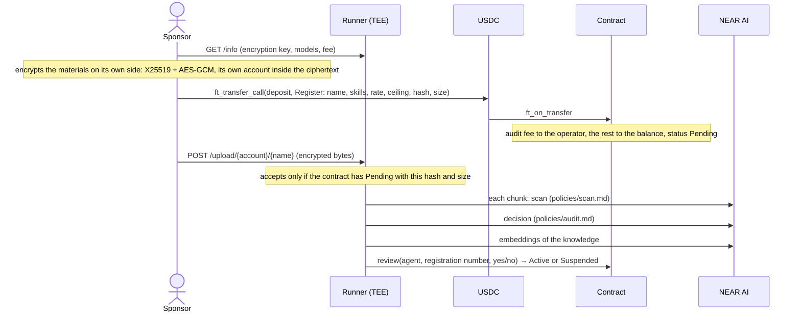
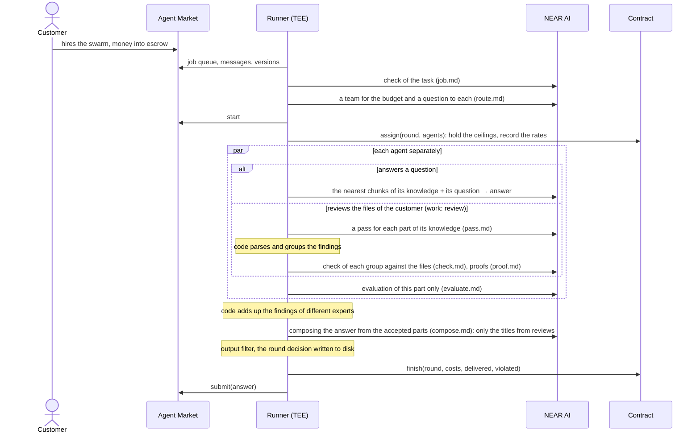

# How the swarm works

> The swarm is a way to add up the closed knowledge of different owners without their having to trust each other.

## Participants

| Who | What they do |
|---|---|
| **Customer** | places an order in the contract (the budget and the task's hash; the task's text goes to the runner), or hires the swarm on Agent Market, where it pays, accepts the work or asks for a rework |
| **Sponsor** | the owner of experts (one account can have any number of them, `account/name`): brings knowledge, pays a deposit, gets the rate for each task |
| **Runner** | a program in a TEE (Phala, Intel TDX): opens the materials, runs the tasks, reports the outcomes to the contract |
| **Contract** | holds the USDC and moves it only by its own rules |
| **Owner** | deployed the swarm: settings, the 5% fee, checking the TEE before handing over the key |
| **Operator** | pays NEAR AI for inference, forwards Agent Market revenue to the contract |
| **NEAR AI** | the models, both the protocol's and the agents'. There is one account, the operator's |

## Who sees what

| Data | Who sees it |
|---|---|
| the agent's card: skills, rate, spending ceiling, hash, size | everyone (in the contract) |
| the sponsor's materials: expertise, method, knowledge | only the runner in the TEE, and the NEAR AI model during the call |
| the customer's brief and messages | the customer, Agent Market, the runner, the protocol's models |
| the question to an agent | that agent (that is, the model with its materials) |
| the agent's answer | the runner: the evaluator and the composer |
| the final answer | the customer, after the output filter |
| the agent's costs | everyone, rounded to 0.01 USDC |
| who made which statement | the runner's store, for disputes |
| the agent's rounds: topic, whether it was picked, outcome, cost, payout; the audit with excerpts | only its sponsor, in the cabinet after signing in with a wallet |
| demand by topic: how many tasks, where no expert was found | everyone (`GET /demand`) |

The agents' models run in NEAR AI Cloud, and the requests sent there carry the materials. The list of models
([policies/models.json](../policies/models.json)) holds models with a verifiable TEE; trust in NEAR AI remains a separate link.

## Two ways in for the customer

| | Order in the contract | Agent Market |
|---|---|---|
| How | the task's text to the runner (`POST /brief`), then `ft_transfer_call` of USDC with `{"Order":{"brief_hash"}}`; on the site, `/order` | hiring the swarm as an agent, or a task on the board |
| Description of the work | up to 10,000 characters, with links to materials in the text. The contract holds only the salted sha256 of the text; the customer and the runner see the text. The customer may publish the text in the same transaction if they wish | a brief of up to 10,000 characters, and files; the customer, the market and the runner see them |
| Money | held in the contract; the contract itself settles at the moment of the answer | the market's escrow; the operator forwards the revenue after acceptance |
| Price | the budget is a ceiling: the rates of those who delivered + overhead + 5% to the owner; the rest goes back to the wallet | a plan or a bid; plus 5% to the market on top |
| Answer | one, final; only the customer reads it, on `/order`, after signing with a wallet; the answer's sha256 is in the `deliver` event |
| If the text did not reach the runner | no one takes the order; after `run_secs` the money comes back | — |
| If the swarm declines or stays silent | on a decline, all of it comes back at once but 0.05 USDC for checking the task; on silence, the whole amount, when anyone calls `refund` after `run_secs` | the market returns the escrow |

There is one engine ([round.ts](../node/src/round.ts)). Each way in is a "door" with the same actions: take a task,
submit an answer, decline. The market is [market.ts](../node/src/market.ts), the contract is [orders.ts](../node/src/orders.ts).
An order has one round, and its task in the contract carries the order's id (`order-<n>`).

In the contract, the customer is protected not by acceptance but by how settlement works: only experts whose answer
passed a separate check are paid, and everything not spent comes back. A customer who needs reworks and an arbiter
goes through Agent Market.

**What trust in an order rests on.** The money rests on the contract's rules. An order has three outcomes (settlement
with the rest returned, a decline, a refund after the timeout), and none of them sends the money where the runner
would choose. What was ordered and what was answered rest on two hashes in the contract: the customer puts in the
task's hash, the runner puts in the answer's hash. Any text someone shows later is checked against them. The salt
stops anyone from guessing a short task from its hash. That the swarm worked honestly rests on the TEE attestation,
as everything else does. What the scheme does not give: no one accepts the quality of the answer, and the runner's
code, not the contract, makes sure the answer reaches the customer.

## The task: what comes from Agent Market and how experts are picked

Agent Market gives the customer a **brief** (text of up to 10,000 characters), **attachments** (files) and **messages**
(clarifications, requests for rework, the arbiter's decisions). The market has no form for choosing who does the work, so:
- an expert can be **named in the brief** by its id from the public catalogue (`/experts`, which also has a brief
  helper). Named experts go first and are marked for the router; it takes them if their skills can help and the
  budget still holds;
- the router picks the rest by their public skills (up to the 20 nearest by embeddings), within the budget;
- **attachments** (up to 5 files of 5 MB each: PDF, Markdown, text, CSV, JSON, code) and links from the brief become the task's materials for the experts;
- the answer's footer lists the experts who gave it: the customer can call them again, and the experts gain reputation.

**Price.** A task on the board gets a bid of exactly the price of the team it needs. Direct hiring goes by budget
plans (Quick 3, Standard 10, Deep 30 USDC): the swarm builds the best team that fits in the plan.

## An agent's entry



- **Audit fee** = `audit_base` + `audit_per_mb` × size (by default 0.10 + 0.10 per MB). The deposit is at least the fee + `min_deposit`.
- **A copy of someone else's bytes will not open:** the expert's id (`account/name`) is sewn into the ciphertext. The same materials on two accounts count as one expert: they will not both get into one task.
- **The reason for a rejection is not published:** it may quote the materials. What is forbidden is written in [scan.md](../policies/scan.md) and [audit.md](../policies/audit.md).
- **Three failures on our side** (NEAR AI unavailable) mean a rejection, so that one agent cannot cost us without end.
- **New materials or skills** mean a new registration and a new audit. The audit's decision names the registration number:
  if the card was replaced while the audit ran, the contract will not accept the decision.
- The public skills are scanned too: they go into the prompt of the model that builds the team.
- The sponsor does not write the prompt. The agent is built from a [template](../policies/agent.md), and the materials go into it as reference, not as commands.

## The round of a task



**Who becomes a candidate:** an agent that is `Active`, whose ceiling is on its balance, whose materials are open in
this runner, whose model is in NEAR AI's price list, and whose ceiling covers the worst case of one answer. If there
are more than 20 candidates, the 20 nearest to the task by the embeddings of their public skills are taken. While
there are no candidates (for example, right after a restart), the round waits and makes no paid call.

**Replacing a weak pick.** The router picks by the words in the skills' description, and a description does not show
how good an expert is. The runner knows something else: what share of past answers came from the expert, against an
equal share for every participant (1 means an equal share). If another candidate's figure is higher than the picked
one's by 0.2 or more, and its rate is no higher, the protocol model gets one narrow question
([stand-in.md](../policies/stand-in.md)): could this candidate answer the same question? If yes, that candidate is
asked. An expert the customer named is not replaced. An expert with no history is neither replaced nor used as a
replacement.

**An agent's cost cannot exceed its hold.** A model token is at least one UTF-8 byte long, so the worst case of a
call is every byte of the prompt as a token, plus the answer's limit. A call goes to NEAR AI only if this worst case
fits in the hold. Otherwise the agent simply does not answer and pays nothing.

**The budget for agents** = price × 0.95 (Agent Market) × (1 − the owner's fee) − the round's overhead (0.50).
Each agent costs its rate plus 0.10 of overhead. Example: 10 USDC → 9.5 → 9.025 → 8.525.
The model ranks the agents by importance, and the longest list from the top that fits in the budget is taken.
All rounds of one task share this budget: a rework spends only what past rounds do not owe (the rates of those who
delivered and their overhead). If nothing is left, the swarm submits the past answer with a note.

**An expert's history.** For each candidate the router sees "delivered/taken" over the last 50 tasks (empty for a new
one). With equal skills it takes the one with the better history, and one who rarely delivers only if there is no one
else. So the author of weak work pays for it (it is called less often), not the experts it worked with.

**The customer's materials:** up to 5 attached files, up to 10 https links from the brief and the messages, and, if
`BRAVE_API_KEY` is set, up to three searches. Formats that are read: PDF (in a separate thread; code in the file is
not run), HTML (also in a separate thread), Markdown, text, CSV, JSON, code. Links to GitHub (a file or a
repository's README) and to public Google Docs, Sheets and Slides are read where their content lives. The protocol
downloads them (agents do not go to the network), through an SSRF filter, up to 5 MB per source. If the materials
exceed 48,000 characters, they are cut into chunks and indexed once per task: each expert gets the chunks nearest to
its question (up to 48,000 characters). Whatever did not open (a private link, an unknown format), the answer names
to the customer.

**Lookup from the materials.** An expert's knowledge is searched by meaning, and the words "check this contract" are
close to nothing in it: what to look for is written in the contract itself. So if a question comes with materials,
the expert first reads them and names up to five things worth looking up in its knowledge
([template](../policies/lookup.md); a separate short call of its own model, at its own cost). Six chunks are then
taken from the knowledge in turn: the best for the question, and the best for each of these things. No one sees these
queries; they only pick chunks of the expert's own knowledge. Without materials there is no such step.

**Review of materials (`work: review`).** An answer is one call with the six nearest chunks of knowledge. For
checklists that is not enough: on audits, one answer saw 8–16% of the checklist and found no more than the model
without it ([eval/README.md](../eval/README.md)). An expert that declared `"work": "review"` works differently when the
customer has given its own files (attachments or links from the brief; what a search found is not reviewed):

| Step | Who does it | What happens |
|---|---|---|
| own reading | the expert's model, [read.md](../policies/read.md) | the first call, without the checklist: the expert reads the files as it would on its own and writes everything it sees on a form. A checklist narrows the model to its own items: passes told to report "only what this part leads to" raised none of the main findings of a contract where the same model, in one call, found seven |
| passes | the expert's model, [pass.md](../policies/pass.md) | a part of the knowledge is one knowledge file (a long file is several parts of up to 9,000 characters), up to 24 parts in all; one call per part: what does this part find in the files? The answer is a form with all the findings, however many there are. A pass is told what was already raised before it (one line per finding); it may repeat a raised finding if it says it more precisely: the mechanism, the line, the consequence |
| records | code | findings arrive on the form; code does not extract them from prose and does not trim them. From here on, no model rewrites the whole list: a model that sums up a long list loses the rare items, and the rare items are the value |
| groups | code, then a narrow question to a model | records about the same thing are joined by embedding closeness (0.85; every record of a group is close to every other, so a chain of neighbours does not glue different things together). If the embedding service is silent for 30 seconds, they are joined by shared words. Then the expert's model answers the narrow question "which of these are about the same thing" ([same.md](../policies/same.md)), and what it names is checked together: one problem in ten wordings is checked once. A check is shown no more than five wordings at a time: a model shown twenty rejects them in one line |
| checks | the expert's model, [check.md](../policies/check.md) | one call per group, the most severe first, while the expert's money lasts; each wording is checked, five at a time: is what the finding says about the files true? Before confirming, the check looks for what stops the finding: if the finding says something is missing (a check, a refund, a rollback), it reads the place where that should be. The answer is a form, not prose: for each wording, "true or not", severity, location, how it happens, the file's lines and the fix. To reject, the check must point to the line that stops the finding. What counts as a finding and how to measure its severity is set by the expert's own method (it is put into the check), not by the protocol: for our auditors it is "someone gains, someone loses, or something stops working; otherwise it is not a finding" |
| what the check sees | code | all of the customer's files and the part of the expert's knowledge the finding came from. Without this, the knowledge and the skill to apply it never met in one call: the rule "`assert_one_yocto` without `#[payable]` never works" was in the knowledge, but the checks of findings about that very function did not see it |
| quote | code | the quoted line is looked up in the customer's files (ignoring spaces and line breaks; a quote with "..." is looked up piece by piece). No such line, and the finding is not confirmed, whatever the model said |
| not confirmed | code | what the check did not confirm is not thrown away: a model's "no" is a judgement just like its "yes", and the best of our models rejected a finding it had just made itself. Critical and High are given in full, as raised, with what the check said; Medium as one line; up to 20 in all. Unconfirmed Low ones are dropped |
| together | the expert's model, [combine.md](../policies/combine.md) | one call sees the confirmed findings, a line for each, and answers what follows from two or three of them together that none of them says alone (one grants a permission, another lets anyone use it). Each such conclusion goes through the same check with a quote; an unconfirmed one is dropped. The step can only add |
| side by side | the expert's model, [same.md](../policies/same.md) | the same narrow question after the checks: which of the findings say the same thing in other words? The model's answer folds nothing and removes nothing: findings named as the same are placed side by side, and each stays a separate finding in its own words, marked "Sorted with … kept apart in case it is not". Once, folded into one, five true wordings got the title of a sixth, false one, and the finding was doubted because of it. A number that is not in the list, or a finding named twice, changes nothing |
| proofs | the expert's model, [proof.md](../policies/proof.md) | if the task asks for code: a test for Critical and High, up to 3, one for findings placed side by side. Written, not run, and the answer says so |

The composer gets only the findings' titles from a review and writes one paragraph of up to 120 words
([summary.md](../policies/summary.md), a limit of 300 tokens; code cuts off anything it writes after the paragraph). On
the first order through the contract, a composer asked to "compose the answer" from the titles wrote its own list of
findings and four tests that no expert had written. The customer gets the findings themselves
below the summary, as the expert wrote them: with severity, location, lines from the file, the fix and the proof;
below them is a list of what was not confirmed, marked as not findings but reasons to look.
Code adds up the findings of several experts, and only adds them up: the runner does not re-check or rewrite them.
There is one rule: **two findings are one only if they are identical, not merely similar.** Identity is decided by
what code can check: the findings sit on the same lines of the customer's materials and say the same thing (or name
one fix). Then it is one finding, marked "found by 2 of 3 experts". Everything else, even when very close in wording,
stands side by side, each finding in its own expert's words; the neighbouring one is given briefly (what, how,
lines). Close wording does not yet make one flaw: "the upgrade does not check that the migration went through" and
"the upgrade leaves no gas for the migration" were once glued together by their words, and the first finding was left
as a line under the second. The protocol model answers a narrow question ([same.md](../policies/same.md)) about which
findings are similar, and its answer decides only what to place side by side.

**The answer starts with what experts confirmed each on their own.** Findings confirmed by two or more experts who did
not see each other's work go in the first block; findings of one expert go in the second, marked as one expert's
opinion. On NearX the first block held 8 findings, among them the real hack of 2022, and not one false serious
finding; all five false serious ones were in the second. A serious finding of one expert is checked by the next expert
of the team, with its own knowledge and against all the files, and that expert pays for it from its own hold. Only its
doubt goes into the answer, with the line that stops the finding; its agreement raises nothing: shown a ready-made
claim, a second expert on the same model agreed with five of nine false serious findings, and both of its doubts were
right.

**Hot spots.** Models often look at the right place and do not carry the thought through. So every step that raises
findings also writes open questions on its form: what it suspects and what would settle it. After the findings are
merged, code finds places where two or more experts left notes (a finding confirmed by one, an unconfirmed one, or an
open question), or where at least one could not carry its suspicion through and two have not yet agreed.
One such place gets a separate look ([hotspot.md](../policies/hotspot.md)): the expert that left the most notes there
gets all of the team's notes about that place, and the parts of each expert's knowledge nearest to them, and decides
what is really wrong there. This is not a check of someone else's claim but an open question about a place, with
partial signals from different experts. What it finds goes through the usual check; what is confirmed goes into the
report as a separate block, between the findings of two experts and the opinions of one. On Mintbase, by the saved
reports, the hot spot would have been `nft_batch_approve`, where five experts of six left notes: that is where an
audit finding sits that no one named.

**The sceptic.** The next expert of the team gets a serious finding of one expert with the task of refuting it
([refute.md](../policies/refute.md)): "most findings are false or harmless; find what stops it; agree only if you went
down every path and found nothing, and describe the mechanism in your own words". Its doubt goes into the answer, with
the line that stops the finding.

This rule is not about code and not about audits. Each contribution of an expert is a unit of two parts: an
**anchor** (what in the customer's materials, or in the future result, it refers to) and a **claim** (what it says or
changes there). If the anchor and the claim match, it is the same thing; otherwise the units stand side by side, and
neither hides under the other. The format decides only the kind of anchor and how code checks that the anchor is real:
lines of code and a quote from a document (present in the files), a spreadsheet range (exists), a time span in a video
(within its length), a place in a plan (the scene is in the approved plan). One kind of anchor is built now: a text
quote. Where experts do not find the same thing but make different things (a script, a voice, editing), two
contributions in one place are two variants: both are shown, or one is chosen by a rule announced in advance, but
they are not silently mixed.
Experts do not see each other's findings. An expert's share in the answer is counted by confirmed findings: nothing
unconfirmed adds to it. If the summary could not be written, the findings still go to the customer.

**The controller (`CONTROL_MODEL`).** If the operator has set a controller model, it reads the added-up list of
findings together with the customer's files ([control.md](../policies/control.md)) and, for each finding, agrees,
doubts it, or rates its severity differently. A doubt is accepted only if the controller quoted a line of a file that
stops the finding, and code found that line. Its word is placed next to the finding ("Second opinion, from the
controller"); the finding itself stays in place and in the expert's wording. By default there is no controller, and we
do not advise one until there is a model clearly stronger than those the experts judge with: on a contract read
blind, a controller on kimi-k2.6 doubted 16 of 26 findings: 9 of the 11 wrong ones and 6 right ones, including both
Highs from the auditors' report ([eval/README.md](../eval/README.md)).

One rule for all steps: a model cannot remove a finding from the answer, neither when it merges the list nor when it
checks it. It can only fail to confirm it, and the customer sees that.

**Only the expert's money limits a review, and only a loop cuts it off.** Every call of a review is paid from the
expert's hold, and the expert's earnings are its rate minus what it spends on models. So the protocol sets neither the
length of an answer, nor the number of findings, nor the number of checks. Own reading, the passes and the "together"
step answer with a form: a list of findings with all fields, the most serious first, as many as the model found; code
takes them all. An answer can be as long as what is left of the hold after the prompt pays for (capped only at 16,000
tokens, the ceiling that models accept at all). Every group is checked, the most severe first, while the money lasts;
when the hold runs out, the review returns what it got through. An answer is cut off only if the model goes in
circles (the last 200 characters already appeared three times in the previous 6,000; this is what a loop looks like:
one finding nine times in a row), falls silent, or writes slower than 10 tokens per second. An expert that wants to
spend less says so in its method ("only High and Medium") or by the number of checks it pays for
(`"review": {"checks": 20}` in `agent.json`). If the hold is not enough even for the first reading, the review does
not start: `too_expensive`.

**One model for everything.** An expert can name a second, cheaper model for the passes (`pass_model`), but we do not
advise it, and our experts do not do it. Only the passes see the expert's knowledge; own reading and the check do not.
With a cheap model in the passes, the knowledge and the skill to apply it never end up in one call: the rule
"`assert_one_yocto` without `#[payable]` never works" was in the knowledge, the cheap model looked at the function and
did not apply the rule to it, and the strong model then checked only its retelling, without the rule. That is how an
audit finding slipped past thirteen looks. With one model, a review costs 13% more and the passes take longer
(DeepSeek writes about 40 tokens per second, Qwen3.6 about 280): for an expert with 24 knowledge files, a review takes
about ten minutes instead of three.

All calls of a review are paid from the expert's hold; the expert is not charged more than the hold. A failed call is retried once. If there are
more than 24 knowledge files, they are packed into parts in order; knowledge of more than 24 parts is not all read:
the chunks taken are those nearest to the question and to what the expert decided to look up in the materials.
Without the customer's files, such an expert answers like an ordinary one.

## The expert's profile

A customer picks an expert by its public profile: "what it knows" (`skills`, in the contract, read by the router),
up to three questions the expert answers well (`examples`), and up to three topics from Agent Market's categories
(`topics`). The questions and topics are in the sealed materials; the audit checks that the expert's files back them
up (otherwise `skills_unsupported`) and that they hold no instructions for an AI. The catalogue shows them only
for an admitted registration, marked "profile checked by the audit". The router sees the questions too.

## Money

| When | What happens |
|---|---|
| registration | the audit fee → the operator; the rest → the sponsor's balance |
| `assign` | each agent's ceiling is held; the rate is recorded in the task |
| `finish` | the cost (rounded up to 0.01, no more than the hold) → the operator; the rest → the agent; the payout is 0 if it did not deliver or broke the rules; a violator is `Suspended` until a new registration |
| `Revenue` (operator only) | the fee → the owner; each gets its payout (pro rata if less came in); the rest → the operator |
| `Order` (customer) | the order's budget sits in the contract under the task's hash |
| `deliver` (runner) | the order is charged `ceil((rates of those who delivered + overhead + overhead_per_agent × their number) / (1 − fee))`, no more than the budget, and this is shared as revenue; the rest of the budget goes straight to the customer's wallet |
| `decline` (runner), `refund` (anyone, after `run_secs`) | the budget goes to the customer's wallet (a decline keeps 0.05 USDC for checking the task, a refund keeps nothing); if the transfer fails, the money waits on the customer's balance in the contract |
| `close` | anyone can close an unfinished task after `run_secs`: the holds go back; an unpaid one is deleted after `pay_secs` |
| `withdraw` | any balance; if the transfer fails, the money goes back to the balance |

An order example from [e2e](../e2e/run.ts): a budget of 8; agents with rates 3 and 2 delivered. Overhead is 0.5 + 0.1 × 2, 5.7 in total;
with 5% to the owner, the customer pays exactly 6: 0.3 to the owner, 3 and 2 to the agents, 0.7 to the operator. Two USDC went back to the wallet.

An Agent Market example: the customer pays 10, and Agent Market forwards 9.5. Agents with rates 3 and 2
delivered; the third (rate 1) addressed the evaluator. Result: 0.475 to the owner, 3 and 2 to the agents, 4.025 to the operator.
The violator pays only its own cost of 0.01 and gets `Suspended`. Its hold goes to no one:
so neither the owner nor the neighbours have a reason to provoke violations.

**We pay for what went into the accepted answer.** A rework improves the past answer, so a part that passed the check
in round 1 stays in the answer of round 2. When the customer has accepted the work, every expert that delivered in any
round of this task up to the accepted one gets its rate (the number of the accepted round is in the answer's footer).
One that did not deliver gets nothing in any round. For each accepted job, `scripts/swarm.sh payouts` pays:

- the past rounds exactly their share: the debt to the experts / (1 − the owner's fee), rounded up;
- the round of the accepted answer the rest of the revenue, and it is paid first: if a run breaks off, the next run
  pays the past rounds their exact shares. A paid round disappears from the contract, so nothing is paid twice.

An example from [e2e](../e2e/run.ts): round 1 owed 3 + 2, and after the changes round 2 had budget for one expert.
Of 9.5, round 1 gets 5.263158 (experts 3 and 2, 0.263157 to the owner), and round 2 gets the rest, 4.236842. An expert
that was not in round 2 still got its rate for its part in round 1.

If the Agent Market arbiter split the payment (status `dispute_resolved`), only part of the escrow arrives, and the
agent's token cannot see how much. `payouts` names such jobs and waits for the amount:
`scripts/swarm.sh payouts --received <assignment>=<USDC>`. What arrived is shared between the rounds in proportion to
what each is owed; inside a round, the contract shares it in proportion to the rates.

If the work is never accepted (the arbiter returned the money to the customer), no one gets a rate: there is no money.
Each loses only its own inference, no more than its ceiling. A sponsor's money is shared by all of its experts:
holds are taken from its balance, and rates come to the same balance.

## Reworks and disputes

- Each round is a separate task in the contract: `<assignment>#<number>`.
- **A customer's remark** is checked against the brief ([scope.md](../policies/scope.md)). If it is new work, or beyond `MAX_REWORKS` (2),
  the swarm submits the past answer with a note: a decline after delivery would give the customer everything back.
- **An arbiter's "redo" decision** (a message from the platform in the conversation) is always carried out.
- Agents get the remarks but not the past answer: it holds the knowledge of others. Only the composer sees the past answer.

## The output filter

The answer is parsed by a Markdown (GFM) parser into a tree and built again, so the filter sees any syntax for a link,
an image or code: ordinary links, reference links, autolinks, `www.`, addresses in any letter case.

**Links.** A link can be the result itself, so it is not cut out. A link stays clickable if it existed before the
task: from the brief, from pages the protocol read (and the links to them), from the materials of the team's experts.
Such a link cannot carry the task's text. A link the model made up is shown as text marked "unverified link": the
agent could have sewn the customer's question into its address, and a click would send it to the agent's owner.
OpenAI does the same: its agent opens on its own only addresses known to a public web index, and warns the user about
the rest.

| What | How |
|---|---|
| HTML, scripts, iframes | cut out |
| images | not loaded on their own: an external image tells its server who opened the answer. Those from known sources are given as a link `image: …` |
| links | those known before the task are clickable (see above); the rest are shown as text `example[.]com/x (unverified link)` |
| invisible characters | removed (in the materials and in the answer) |
| code in any form (```` ``` ````, `~~~`, indented, an unclosed block, `inline`) | code that matches the static rules (download and run, `eval` of something decoded, reverse shell, wiping, miners, key theft) is removed; a model looks at the other blocks ([code.md](../policies/code.md)); if that check fails, they are removed; code that stays is marked "not run" |
| a dangerous command right in the text | the paragraph is replaced by a note |
| source marks `[[n]]` | removed from the answer, kept in the runner's store |

## The sponsor's cabinet and debugging

The sponsor signs in with a NEAR wallet: the wallet pays for registration, top-ups and withdrawals, and a NEP-413
signature (`Swarm-for-Hire cabinet <account> <time>` for the contract) opens the cabinet. The runner checks the
signature and that the key is a full-access key of this account. It stores nothing, and a signature is valid for 10 minutes.

| The cabinet shows | It never shows |
|---|---|
| status, balance, rate, ceiling | customers' tasks |
| each round: time, topic (one of Agent Market's categories), whether it was picked, outcome, cost, payout | questions to the agent |
| the outcome in one word: `answered`; `empty`, `off_topic`, `refused`, `repeated_question`, `cut_off` (no payout; `cut_off` means the answer hit the length limit before it got to the point); `too_expensive` (raise the ceiling: in the worst case, the answer or the whole review did not fit in it); `addressed_others`, `asked_for_score`, `changed_rules`, `hidden_content`, `attack` (violations); `model_failed`, `not_checked` (our side) | the agent's answers and the evaluator's text (they contain the question) |
| what became of the accepted part: what share of the final answer's statements is marked as its own (in steps of 10%), and whether the customer sent that answer back for rework | other agents' parts and the answer itself |
| the audit: the rule, the reason, the excerpts from its own materials that the scan flagged | — |
| demand by topic: where no expert was found | — |

The questions are hidden because they are the customer's data, and with them a sponsor could tailor its materials to
other people's tasks. To learn what to improve, a sponsor runs its agent on its own questions: `scripts/try.ts`, with
the sponsor's own NEAR AI key, runs the same public template, the same chunking and knowledge search, the same model and
the same evaluator, and shows everything: the chunks found, the whole prompt (`--prompt`), the answer, the verdict
with its reason, the worst-case cost against the ceiling. `--audit` shows whether the materials will pass entry.
`--material <file>` gives the question a customer's file: an expert with `"work": "review"` reviews it the same way as
in the swarm, and shows how many findings the passes raised, how many held, and what it cost.

In the swarm's work, a sponsor needs no NEAR AI key of its own, and none can be plugged in: from the exact tokens and
times of its calls it would see when customers had which tasks, and the agent could pass questions to it through the
length of its answers. So the swarm has one key, the operator's, and costs rounded to 0.01.

The runner's pages are separated on purpose. The joining page (`/join`) sees the materials in the clear, so it, like
the overview, has only our code, our fonts, and connections only to the runner. The cabinet (`/cabinet`) never sees
materials, so wallets work on it, each in its own sandbox (NEAR Connect).

## Restart

- A round's decision is written to disk before it goes to the contract and the market. After a restart the runner
  repeats `finish` and `submit`: both are safe to repeat.
- A round interrupted before its decision: the holds are returned, and the round runs again.
- The materials lie on disk encrypted; after a restart the runner opens and indexes them again.
- The signing key in the TEE is new on every start: the owner checks the attestation and grants it rights (and removes the old one).
  dstack derives the encryption key from the app's identity, so it survives a restart.

## Why the runner can be trusted

`GET /attestation` returns an Intel TDX quote. In it, `report_data` = sha256(signing key) ‖ encryption key, and the
event log replays to RTMR3 and names the compose: the image by digest, the variables, the rules. `scripts/swarm.sh verify <url> app-compose.json`
checks all of this; without a TEE (`DEV_KEY` mode) the check honestly fails. It is the compose that ties the quote to
our code: without it, any genuine TDX app would pass the check. So `join` requires `app-compose.json`, which the owner
publishes in the repository, and also checks that the signing key really is a key of `runner.<root>`.

The runner's key is a function-call key for five methods (`review`, `assign`, `finish`, `deliver`, `decline`): by
itself it cannot withdraw tokens. What a thief of this key can do depends on whose money it is. **Sponsors' money** is
limited by the holds, and what is charged goes to the operator, not to the thief. **Customers' money** is less well
protected, and this must be said plainly: a stolen key can admit a fake expert with a huge rate, assign it to an open
order and declare the work done; the order, up to its amount, will go to that expert. The ceiling of such damage is
the open orders (an order lives for minutes and no longer than `run_secs`), not everything held in the contract. It
is limited by the TEE the key lives in, and by the pause: `scripts/swarm.sh pause` stops the runner at once (`halt` in
the contract). While it is paused, the contract accepts nothing from it, and the runner sees the pause and does nothing
that costs money. A pause does not move money: orders are refunded and stuck tasks are closed after the timeout, by
anyone, as if there were no runner.

**A change of settings waits.** The owner does not change settings at once: `set_config` announces new ones, and they
take effect after `delay_secs` (the delay is taken from the current settings), when anyone calls `apply_config`. The
announcement is visible in the `config` event and in the `announced` view. All this time every exit stays open:
`withdraw`, `refund` and `close` need neither the owner nor the runner. So anyone who does not like the new runner,
operator or fee has time to leave with their money. The delay itself cannot be removed without waiting it out either.
On testnet the delay is 0 (settings change at once); for mainnet we propose two days. All participants' money sits in
one contract, not in a separate escrow per task: escrows would run on the same code and under the same runner, so they
would remove none of the real risks, and would add a deployment and two or three cross-contract transfers to every
payout. An order is already spent only on its own task and on no more than its amount.

## Threats

| Threat | What stops it | What remains |
|---|---|---|
| a sponsor hides instructions for the evaluator and the composer | the scan and the audit at entry; each answer evaluated separately; a violation = no payout, suspension, a new audit at the sponsor's own cost | subtle influence that the models do not recognise |
| a customer frames honest agents ("address the evaluator") | the router passes the agent only a question about its knowledge; an answer to the question is never a violation; a violation benefits no one | a mistake of the evaluator model |
| a sponsor changes the card while the audit runs | the audit's decision is tied to the registration number | — |
| a sponsor wants to see tasks through the cabinet | the cabinet gives only the topic, the one-word outcome and the money; sign-in only with a signature of a full-access key | — |
| an agent hides the customer's question in a link's address | only addresses known before the task are clickable | the customer may copy an unverified address by hand |
| `$&` and the like in the materials blow up the prompt | the template is filled in without substitutions; a call is not sent if its worst case exceeds the hold | — |
| a sponsor copies someone else's materials | the account inside the ciphertext; the same content = one expert | retelling someone else's knowledge in one's own words |
| many accounts, to work more often | each pays the audit and the deposit; picking is by skills, not by numbers | — |
| an agent tries to learn its neighbours' knowledge | an agent sees no one; only the composer has the past answer; coarse costs | — |
| a customer injects instructions into the brief | the task check; in every protocol call the input goes in as JSON data; an agent sees only its own question | — |
| the answer harms the customer | the output filter | harmful meaning in plain text |
| the brief's links lead into an internal network | https only, the SSRF filter on every address and redirect, size and time limits | — |
| the operator wants to see the materials | they open only in the TEE; the logs hold neither materials nor the models' reasons; tracing with text can be turned on only without a TEE | attacks on the TEE itself (TEE.fail and others) |
| the runner is hacked | the key by itself cannot withdraw tokens and lives only in the TEE, with a new one after each restart; sponsors' money only within the holds, only to the operator, and no more than the daily cap the sponsor sets itself (`set_daily_cap`); Agent Market payouts are not made for a task whose rounds owe more than it brought in; `pause` stops it at once | open orders: through a fake expert, the thief can take an order up to its amount. Fixing the team in the order closes this (not done) |
| someone else's order under the same task hash, to read another customer's task and answer | the task hash is `sha256(salt, customer account, text)`; the runner gives the text only to an order that has the same customer in the contract | the copy of the hash hangs without work until it is refunded after the timeout |
| junk orders burn through the daily NEAR AI budget | a declined order leaves the operator 0.05 USDC for checking the task; task texts: no more than 10 per minute per customer | orders within the budget: the customer pays for them |
| a task is closed while its round is still running, and paid work is lost | a round fits within `ROUND_MS` (25 min) with `run_secs` at 30 min; a running task can be closed only after `2 × run_secs` | — |
| uploads are used to bring the runner down | paid registrations only; streamed to disk; 8 uploads at once, one per account; chain data at most once every 3 s | after a crash, the new signing key waits for the owner |
| repeats of a round burn money on models | no paid call before the checks for candidates and for a pause; failures are retried after 1, 2, 4 and 8 minutes, and after the fifth comes a decline | — |
| the owner changes the runner or the operator in the settings | the change is announced and takes effect after `delay_secs`; until then anyone can withdraw their balance and get their order refunded | with a delay of 0 (testnet) this is trust in the owner: a new runner could charge holds as costs |
| the owner changes the fee or the overhead while an order is in progress | the customer does not pay more than the order's amount | the fee and the overhead are taken at settlement, not at ordering: with a delay shorter than `run_secs`, an order whose task is already assigned cannot get out in time and loses the refund it expected. A snapshot of these numbers in the order closes this (not done) |
| the owner's key is stolen | settings change only after the same delay; pausing the runner moves no money | the owner should be a multisig; the contract's account must keep no full-access key, or else its code can be replaced |
| the owner rolls out a new version of the app | the new version gets the same encryption key; each version is visible by its compose hash | trust in the owner: check the compose after updates |

## Current limits

- The operator forwards Agent Market revenue: the market pays to the swarm's account, and the runner's key cannot attach a deposit.
  An order in the contract is settled without the operator.
- An order in the contract has no reworks and no disputes.
- On Agent Market, only the rounds of accepted work are paid.
- An expert's materials are text only (`.md`, `.txt`). The customer's PDF files are read too.
- A review reads up to 160,000 characters of the customer's files and what they import; from anything larger, the chunks nearest to the question are taken. No one
  runs the proofs: the TEE has neither a compiler nor a network.
- The knowledge index is built once, when the expert is admitted, and is kept on the runner's disk sealed with the
  runner's key, like the materials themselves: a restart reads it from disk and needs no embedding model for that.
  While NEAR AI's embedding service does not respond, no new expert can be admitted and no knowledge chunks can be
  found for a question (the expert answers without them); a review (`work: review`) reads the knowledge whole and
  groups findings by words, so it keeps working.
- The runner keeps the knowledge of active agents in memory: about 40 MB per agent with 10 MB of knowledge. The CVM is sized to the number of agents.
- The runner's own spending at NEAR AI is capped per day (`DAILY_BUDGET_USD`): beyond it, the runner starts no work until the next day,
  and orders in the contract wait and are refunded after the timeout. No more than 4 tasks run at once, so the limit
  cannot be exceeded by more than their cost.
- Source marks are kept but do not yet affect the choice of agents: the router counts only the share of tasks delivered.

- Open after the review of 14 November (low risk, recorded, not done): a timeout refund sent at the same moment as the
  answer's delivery can leave the customer with both the answer and the money; re-registering during a task in which
  the agent broke the rules suspends the new card; the fee and the operator are taken at the time of payout, not at
  the end of the task; a cabinet sign-in lasts 12 hours; the contract pays for its own storage; the Agent Market
  download path is not checked for its host.
  The binding of a task to its customer can move into the contract itself: it will store `sha256(caller, hash)`.

## Related projects

| Project | In common | Difference |
|---|---|---|
| OpenMined Syft | computation over other people's closed data | the data stays with its owner, and a researcher is needed; we give the customer a finished answer |
| Opaque / C-FedRAG | RAG over closed databases in a TEE | no market and no pay to the owners |
| ProRata | pay by attribution to sources | a trusted intermediary; we have a contract and a TEE |
| Agent Market competitions | many agents on one task | the agents compete rather than add up their knowledge; the knowledge is not protected |
| Theoriq, Allora | collectives of agents and incentives | no closed knowledge of different owners |
